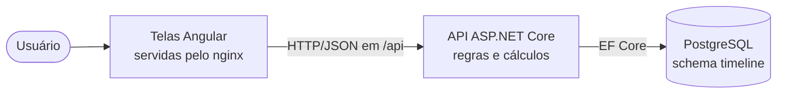
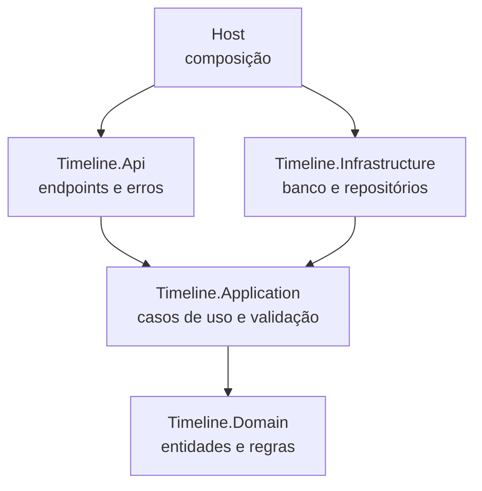
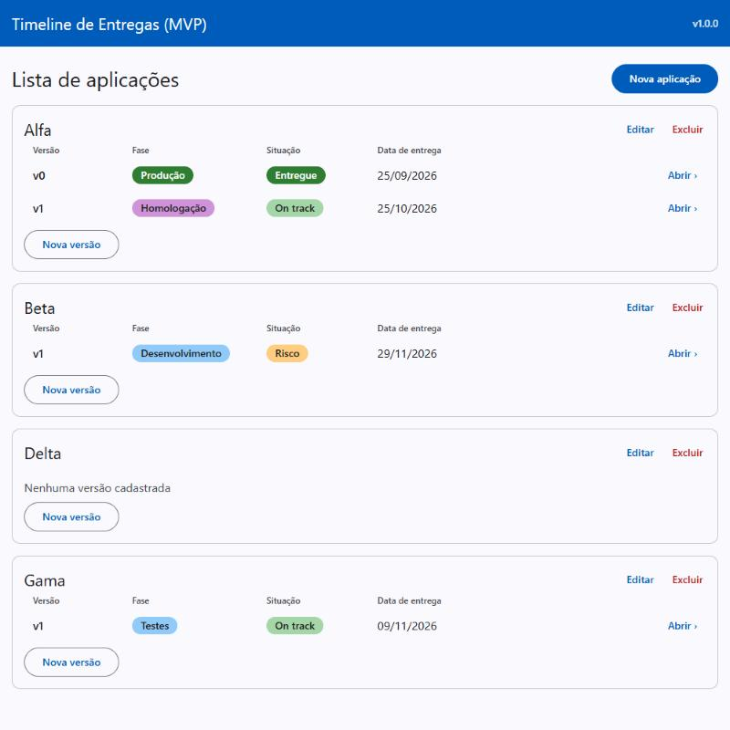
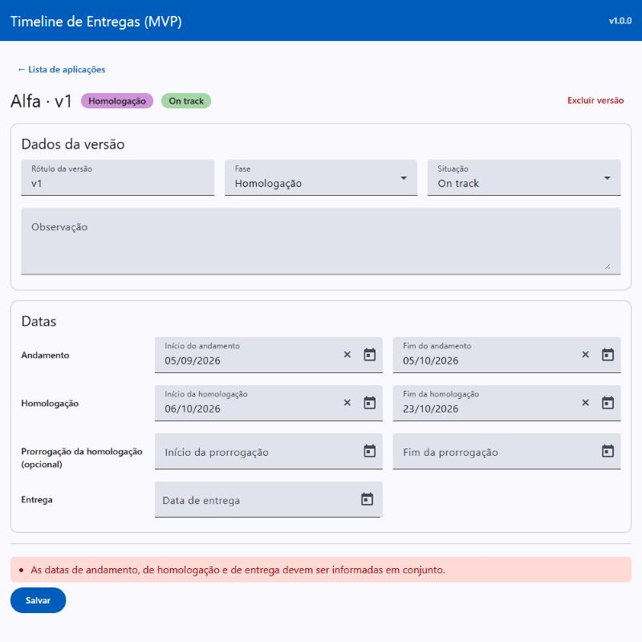

# Timeline de Entregas (MVP)

Sistema local para manter o status report semanal de um projeto de software a partir de um único cadastro de aplicações e versões, no lugar da manutenção manual em slides.

> **Versão 1.0.0 — entrega parcial planejada.** O projeto foi construído em degraus, e cada degrau termina com algo funcionando. Esta versão entrega os dois primeiros: o cadastro completo de aplicações e versões, pela API e pelas telas. A timeline, a tabela de status das aplicações e o congelamento semanal estão especificados e ficaram para os próximos degraus ([seção 14](#14-limitações-e-próximos-passos)).

## 1. Descrição

**O problema.** O status report semanal do projeto é mantido à mão, em PowerPoint, com uma timeline de entregas e uma tabela de status das aplicações. A atualização leva pelo menos 1 hora por semana, a timeline nunca fica alinhada às datas reais, a mesma informação é repetida em mais de um slide, e cada mudança de data é redesenhada manualmente.

**A solução.** Um cadastro único de aplicações e versões, que passa a ser a fonte das informações do status report, no lugar dos dados repetidos nos slides. Cada versão guarda fase, situação, observação e as datas de cada etapa (andamento, homologação, prorrogação da homologação e entrega), e a API confere as regras de negócio a cada salvamento: datas em ordem, fases em sequência (que, a partir da Homologação, só avançam) e Produção só com a entrega já ocorrida. Com os dados certos num só lugar, os próximos degraus desenham a timeline e a tabela de status a partir deles, e congelam o status report de cada semana.

Os requisitos desta versão estão em [`docs/negocio/requisitos-mvp.md`](docs/negocio/requisitos-mvp.md).

## 2. O que foi entregue

**Funcionando nesta versão**

- **Aplicações:** cadastrar, renomear e excluir, com confirmação antes de excluir. Nomes que diferem só em maiúsculas ou em espaços nas pontas são considerados iguais ("Alfa", "alfa" e "Alfa ").
- **Versões:** cadastrar, editar e excluir as versões de cada aplicação, com rótulo único dentro da aplicação.
- **Tela da versão:** rótulo, fase, situação (On track ou Risco), observação e as sete datas num único formulário, com um só botão Salvar, que grava tudo ou nada.
- **Lista de aplicações:** cada versão aparece com fase e situação em etiquetas coloridas (Backlog e Não iniciado em cinza, Análise, Desenvolvimento e Testes em azul, Homologação em roxo, On track em verde claro, Produção e Entregue em verde escuro, Risco em laranja) e com a data de entrega em dd/mm/aaaa, ou "TBD" quando a versão não tem datas. A barra de título mostra "Timeline de Entregas (MVP)" e a versão do sistema.
- **Situação e observação:** em Backlog a situação é "Não iniciado" e em Produção é "Entregue", sempre automáticas e só para leitura; nas demais fases, On track ou Risco. Quando a situação é Risco, a observação é obrigatória: "Informe a observação quando a situação for Risco."
- **Regras de fase e datas:** as fases seguem a ordem Backlog, Análise, Desenvolvimento, Testes, Homologação e Produção, podendo ir e voltar até Testes, e a partir da Homologação só avançam; sair do Backlog exige as datas; Produção exige a data de entrega igual ou anterior à data atual; as datas são informadas em conjunto e em ordem; a prorrogação só existe na Homologação (e pode ser informada no mesmo salvamento que passa a versão para Homologação); em Produção o campo Fase fica desabilitado, e em Homologação só oferece Homologação e Produção. Ao salvar, a tela volta para a lista de aplicações.
- **Mensagens claras:** todo erro chega à tela com o texto exato de um catálogo de mensagens aprovado.
- **API documentada** numa página no navegador, onde cada operação pode ser testada sem instalar nada.
- **Dados de exemplo fictícios** (aplicações Alfa, Beta, Delta e Gama), com datas calculadas a partir do dia em que o sistema é executado.
- **Um comando para cada coisa:** instalar, executar, testar e verificar o padrão do código, com testes e verificação rodando em container. Scripts em `.ps1` para Windows e em `.sh` para Linux e macOS, conferidos no Windows (PowerShell e Git Bash).

Os próximos degraus (timeline, tabela de status das aplicações e congelamento semanal) já estão especificados, com os critérios de aceite escritos, e estão descritos na [seção 14](#14-limitações-e-próximos-passos).

## 3. Tabela de conteúdos

- [1. Descrição](#1-descrição)
- [2. O que foi entregue](#2-o-que-foi-entregue)
- [3. Tabela de conteúdos](#3-tabela-de-conteúdos)
- [4. Tecnologias utilizadas](#4-tecnologias-utilizadas)
- [5. Pré-requisitos](#5-pré-requisitos)
- [6. Dependências e ambiente](#6-dependências-e-ambiente)
- [7. Instalação e execução local](#7-instalação-e-execução-local)
- [8. Uso e exemplos](#8-uso-e-exemplos)
- [9. Estrutura do projeto](#9-estrutura-do-projeto)
- [10. Arquitetura da aplicação](#10-arquitetura-da-aplicação)
- [11. Testes](#11-testes)
- [12. Como a IA foi usada no desenvolvimento](#12-como-a-ia-foi-usada-no-desenvolvimento)
- [13. Demonstração visual](#13-demonstração-visual)
- [14. Limitações e próximos passos](#14-limitações-e-próximos-passos)
- [15. Créditos e licença](#15-créditos-e-licença)

## 4. Tecnologias utilizadas

Todas as ferramentas são gratuitas. As versões exatas ficam nos arquivos de dependências ([seção 6](#6-dependências-e-ambiente)).

| Parte | Tecnologia |
|---|---|
| Backend (API) | C# e .NET 10, ASP.NET Core no estilo Minimal APIs |
| Acesso a dados | Entity Framework Core com o provedor Npgsql, migrations versionadas |
| Banco de dados | PostgreSQL 17 |
| Documentação da API | OpenAPI gerado pela própria API, com a página Scalar |
| Frontend (telas) | Angular 22 com TypeScript e Angular Material, idioma pt-BR |
| Testes | xUnit e o relógio falso da Microsoft (backend); executor de testes padrão do Angular (frontend) |
| Verificação do padrão do código | `dotnet format` (backend) e `ng lint` com angular-eslint (frontend) |
| Execução | Docker e Docker Compose; telas servidas pelo nginx |
| Controle de versão | Git e GitHub, com Conventional Commits |

**Assistente de IA usado no desenvolvimento**

| Ferramenta | Modelo | Onde foi usado |
|---|---|---|
| Conversa no claude.ai | Claude Opus 5.5 | Planejamento: revisão de requisitos e de arquitetura, processo, tarefas e roteiro de prompts; conferência final da entrega |
| [Claude Code](https://docs.claude.com/en/docs/claude-code/overview), pela área Code do aplicativo Claude | Claude Sonnet 5.5 | Planos e implementação das tarefas T-02, T-03 e T-05 a T-10, e a entrega (T-20 a T-22) |
| Claude Code | Claude Opus 5.5 | Implementação da T-04, as regras de negócio da versão |

A aplicação em si não usa IA: o problema é resolvido por regras previsíveis (ADR-04 do [`arquitetura.md`](docs/tecnico/arquitetura.md)).

## 5. Pré-requisitos

Para **usar e avaliar** o projeto, basta instalar:

| Ferramenta | Versão | Para quê | Onde obter |
|---|---|---|---|
| Git | Qualquer versão recente | Baixar o projeto | [git-scm.com/downloads](https://git-scm.com/downloads) |
| Docker | Com o Docker Compose v2 (o comando `docker compose`, com espaço), que já vem no Docker Desktop | Rodar o banco, a API e as telas, e executar os testes e o lint em container | [docs.docker.com/get-started/get-docker](https://docs.docker.com/get-started/get-docker/) |

**Numa máquina sem nada instalado**

1. Instale o Git pelo link da tabela, mantendo as opções padrão do instalador (no Windows, elas incluem o Git Bash).
2. Instale o Docker. No Windows, aceite o WSL 2 quando o instalador pedir e reinicie o computador ao final. No Linux, siga também o passo do guia que permite usar o Docker sem `sudo`.
3. Abra o Docker Desktop e espere ele indicar que está em execução (no Linux, o Docker Engine já fica em execução depois de instalado).
4. Abra um terminal (PowerShell, no Windows) e confira a instalação. Cada comando deve responder com um número de versão:

   ```bash
   git --version
   docker --version
   docker compose version
   ```

5. Siga para a [seção 7](#7-instalação-e-execução-local), com o Docker aberto.

> **Sobre a licença do Docker Desktop:** ele é gratuito para uso pessoal e em empresas pequenas, mas exige assinatura em empresas de maior porte. Há alternativas gratuitas, como o Docker Engine no WSL 2.

Só para **desenvolver** (alterar o código), instale também o [SDK do .NET 10](https://dotnet.microsoft.com/download/dotnet/10.0), versão 10.0.302 ou mais recente da linha 10.0 (fixada no `global.json`), e o [Node.js 24](https://nodejs.org/pt/download), versão LTS, a mesma usada nos containers. Os scripts de teste e de lint **não** exigem o SDK nem o Node.js instalados.

## 6. Dependências e ambiente

Cada parte do sistema declara as suas dependências num arquivo próprio, com as versões registradas pelas ferramentas oficiais (`dotnet add package` e `npm install`), nunca escritas à mão. Esses arquivos cumprem o papel que o `requirements.txt` e o `pyproject.toml` têm em projetos Python.

| Arquivo | Papel |
|---|---|
| `global.json` | Fixa a versão do SDK do .NET usada para compilar |
| `backend/**/*.csproj` | Pacotes de cada projeto do backend, com a versão de cada um |
| `backend/Directory.Build.props` | Configuração comum dos projetos (.NET 10, avisos tratados como erro) |
| `backend/.config/dotnet-tools.json` | Ferramenta de migrations do Entity Framework Core |
| `frontend/package.json` e `frontend/package-lock.json` | Pacotes das telas; o `package-lock.json` fixa a versão exata de cada um |
| `docker-compose.yml` | Versões das imagens do banco (PostgreSQL 17), do SDK do .NET e do Node.js |
| `backend/Dockerfile` e `frontend/Dockerfile` | Como a API e as telas são montadas em container |
| `.env.example` | Modelo das variáveis de ambiente, só com valores fictícios |
| `.env` | Configuração local, criada pelo script `install` a partir do `.env.example`; **nunca é versionado** |

**Variáveis do `.env`**

| Variável | Para quê |
|---|---|
| `POSTGRES_USER`, `POSTGRES_PASSWORD`, `POSTGRES_DB` | Usuário, senha e nome do banco local |
| `DB_PORT`, `API_PORT`, `WEB_PORT` | Portas do banco (5432), da API (8080) e das telas (4200) no seu computador |
| `TZ` | Fuso horário da API (padrão `America/Sao_Paulo`), para a data atual não virar o dia seguinte depois das 21h |
| `SEED_DADOS_EXEMPLO` | `true` carrega as aplicações de exemplo quando o banco está vazio; `false` não carrega |
| `DB_HOST` | Já vem desativada no `.env.example` e não precisa ser alterada: dentro do Docker, a API encontra o banco sozinha. Serve só para quem desenvolve e roda a API fora do Docker (padrão `localhost`) |

## 7. Instalação e execução local

Você não precisa instalar o PostgreSQL nem criar o banco: o **Executar** sobe o banco num container do Docker, e a API cria as tabelas e carrega os dados de exemplo sozinha.

**1. Baixar o projeto** (em qualquer sistema; no Windows, escolha uma pasta fora do OneDrive e sem espaços no caminho):

```bash
git clone https://github.com/priscilabertolazzi/timeline-entregas.git timeline-entregas
cd timeline-entregas
```

Se você recebeu o projeto em arquivo `.zip`, descompacte-o (seguindo a mesma orientação de pasta), entre na pasta `timeline-entregas` e siga a partir do passo 2. O `.zip` traz também o histórico do Git.

**2. Os quatro comandos do projeto**

| Ação | Windows (PowerShell) | Linux e macOS |
|---|---|---|
| Instalar | `powershell -ExecutionPolicy Bypass -File scripts\install.ps1` | `make install` |
| Executar | `powershell -ExecutionPolicy Bypass -File scripts\run.ps1` | `make run` |
| Testar | `powershell -ExecutionPolicy Bypass -File scripts\test.ps1` | `make test` |
| Verificar o padrão do código | `powershell -ExecutionPolicy Bypass -File scripts\lint.ps1` | `make lint` |

Em Linux e macOS, sem o `make`, use `sh scripts/install.sh`, `sh scripts/run.sh`, `sh scripts/test.sh` e `sh scripts/lint.sh`. No Windows, os arquivos `.sh` também rodam pelo Git Bash.

- **Instalar** cria o arquivo `.env` a partir do `.env.example` (se ele ainda não existir) e baixa as imagens do Docker e os pacotes do backend e do frontend. A primeira vez leva alguns minutos e precisa de internet.
- **Executar** sobe o banco de dados (PostgreSQL), a API e as telas, e informa os endereços:
  - **Telas:** `http://localhost:4200` (porta `WEB_PORT` do `.env`).
  - **Página de documentação da API:** `http://localhost:8080` (porta `API_PORT`).
  - Com o banco vazio, o sistema já vem com as aplicações de exemplo Alfa, Beta, Delta e Gama.
  - Para parar: `docker compose down` (os dados ficam guardados).
- Se o **Executar** avisar que a porta não está disponível, outro programa (por exemplo, um PostgreSQL já instalado) usa a porta 5432. Troque o valor de `DB_PORT` (ou de `API_PORT` e `WEB_PORT`, se for uma delas) no arquivo `.env` (por exemplo, `DB_PORT` para `5433`) e rode de novo.
- O arquivo `.env` guarda a configuração local, inclusive a senha do banco, e **nunca é versionado**. O `.env.example` traz só valores fictícios.
- **A API e o banco:** ao iniciar, a API cria sozinha as tabelas `aplicacao` e `versao` no banco (schema `timeline`) e atualiza o que faltar. Não há nenhum passo manual de banco.

## 8. Uso e exemplos

### Pelas telas

Com o sistema no ar, abra `http://localhost:4200`.

1. **Lista de aplicações.** Aparecem, em ordem alfabética, Alfa, Beta, Delta e Gama, cada uma com as suas versões, a fase e a situação de cada versão em etiquetas coloridas e a data de entrega (ou "TBD"). A Delta mostra "Nenhuma versão cadastrada".
2. **Nova aplicação.** Cadastre um nome. Tente cadastrar "alfa": a tela mostra "Já existe uma aplicação com esse nome." (CA-33). Os botões **Editar** e **Excluir** de cada aplicação renomeiam e excluem; a exclusão pede confirmação e leva junto as versões (RN-04).
3. **Nova versão.** Na Delta, cadastre a versão `v1`. Ela nasce em Backlog, sem datas.
4. **Tela da versão.** Clique na linha da versão (ou em **Abrir ›**). A tela tem dois blocos, **Dados da versão** (rótulo, fase, situação e observação) e **Datas** (uma etapa por linha), e um único botão **Salvar**, numa barra fixa no pé da tela, onde também aparecem as mensagens.
5. **Experimente as regras:**
   - Escolha só a data de entrega e salve: "As datas de andamento, de homologação e de entrega devem ser informadas em conjunto." (CA-25).
   - Mude a fase para Desenvolvimento sem datas: "Informe as datas da versão antes de iniciá-la." (CA-13).
   - Mude a situação de uma versão em andamento para Risco, sem escrever a observação, e salve: "Informe a observação quando a situação for Risco." (CA-43). Escreva a observação e salve de novo: a tela volta para a lista, com "Alterações salvas." (CA-45).
   - Na v1 da Alfa (em Homologação), registre uma prorrogação que termine depois da data de entrega e salve: nada é gravado e aparece "O fim da prorrogação não pode ser posterior à data de entrega." (CA-32). Ajuste a entrega para depois da prorrogação e salve de novo: tudo é gravado.

As datas são escolhidas no calendário (o "×" dentro do campo limpa a data), no formato dd/mm/aaaa.

### Pela página de documentação da API

A página de documentação (Scalar) abre em `http://localhost:8080` com a API em execução. Ela lista as operações, mostra os textos de erro possíveis e permite testar cada uma sem instalar nada.

**Exemplo: conferir a recusa de nome repetido** (CA-33)

1. Na coluna da esquerda, em **Aplicações**, clique em **Cadastra uma aplicação**.
2. Clique em **Test Request**. O corpo já vem com `{ "nome": "Alfa" }`.
3. Clique em **Send**. Como a Alfa já existe nos dados de exemplo, o resultado é `409 Conflict`, com a mensagem **"Já existe uma aplicação com esse nome."** Troque o nome por um novo e envie de novo: `201 Created`, com o `id` e o `nome`.

### Pela linha de comando (`curl`)

Os exemplos abaixo usam os dados de exemplo. No Windows, rode-os pelo **Git Bash** (instalado junto com o Git); no PowerShell, o tratamento das aspas é diferente.

```bash
# Lista as aplicações, cada uma com o resumo das suas versões (id, rótulo, fase, situação e data de entrega)
curl http://localhost:8080/api/aplicacoes

# Tenta cadastrar "alfa", que já existe (CA-33). Esperado: 409 "Já existe uma aplicação com esse nome."
curl -i -X POST http://localhost:8080/api/aplicacoes \
  -H "Content-Type: application/json" -d '{"nome": "alfa"}'

# Cadastra a versão v1 na Delta (troque 4 pelo "id" da Delta na lista). Esperado: 201, em Backlog
curl -i -X POST http://localhost:8080/api/aplicacoes/4/versoes \
  -H "Content-Type: application/json" -d '{"rotulo": "v1"}'

# Grava só parte das datas (CA-25; troque 5 pelo "id" da versão devolvido acima).
# Esperado: 422 "As datas de andamento, de homologação e de entrega devem ser informadas em conjunto."
curl -i -X PUT http://localhost:8080/api/versoes/5/datas \
  -H "Content-Type: application/json" \
  -d '{"inicioAndamento": "2026-09-01", "fimAndamento": "2026-09-25"}'

# Detalha a versão, com todas as datas
curl http://localhost:8080/api/versoes/5
```

**Todas as operações**, na ordem de uso e com o resultado esperado de cada uma, estão em [`http/exemplos.http`](http/exemplos.http), que pode ser executado no VS Code, com a extensão REST Client, ou no Visual Studio 2022, que abre arquivos `.http` sem extensão. O arquivo foi escrito para um **banco vazio**: para segui-lo do começo, ponha `SEED_DADOS_EXEMPLO=false` no `.env` e recrie o banco com `docker compose down -v` (isso **apaga** os dados) antes de executar de novo.

| Método | Rota | O que faz |
|---|---|---|
| GET | `/api/aplicacoes` | Lista as aplicações, com o resumo das versões |
| POST | `/api/aplicacoes` | Cadastra uma aplicação |
| PUT | `/api/aplicacoes/{id}` | Renomeia uma aplicação |
| DELETE | `/api/aplicacoes/{id}` | Exclui uma aplicação e as suas versões |
| POST | `/api/aplicacoes/{id}/versoes` | Cadastra uma versão, só com o rótulo |
| GET | `/api/versoes/{id}` | Detalha uma versão, com todas as datas |
| PUT | `/api/versoes/{id}` | Altera rótulo, situação e observação |
| PUT | `/api/versoes/{id}/fase` | Altera a fase |
| PUT | `/api/versoes/{id}/datas` | Grava as sete datas de uma vez |
| PUT | `/api/versoes/{id}/completo` | Grava tudo de uma vez, tudo ou nada (é o Salvar da tela da versão) |
| DELETE | `/api/versoes/{id}` | Exclui uma versão |

**Como os erros são devolvidos:** sempre no mesmo formato (Problem Details), com o código HTTP (400 dado inválido, 404 não encontrado, 409 nome repetido, 422 regra de negócio, 500 erro inesperado), o campo `title` com a primeira mensagem e a lista `mensagens` com todas elas. O erro inesperado nunca mostra detalhes internos. O texto de cada mensagem está no catálogo do [`arquitetura.md`](docs/tecnico/arquitetura.md), seção 7.6.

## 9. Estrutura do projeto

```
timeline-entregas/
├── README.md, LICENSE, Makefile, docker-compose.yml, global.json, .env.example
├── CLAUDE.md                  # Regras permanentes para o assistente de código
├── scripts/                   # install, run, test e lint, em .ps1 (Windows) e .sh (Linux e macOS)
├── http/exemplos.http         # Requisições de exemplo, na ordem de uso
├── prompts/
│   └── prompts-claude-code.md # Roteiro de prompts de cada tarefa e registro dos pedidos ao assistente
├── docs/
│   ├── negocio/               # Requisitos do MVP e visão completa do produto
│   ├── tecnico/               # Arquitetura (com o catálogo de mensagens e as decisões) e processo
│   ├── tarefas.md             # Tarefas em degraus, estimativas e regra do corte
│   └── imagens/               # Capturas da demonstração visual
├── backend/
│   ├── CLAUDE.md              # Convenções do backend para o assistente
│   ├── src/Host/              # Inicialização e composição das camadas (dispara as migrations e a carga de exemplo ao iniciar)
│   ├── src/Modules/Timeline/  # Domain, Application (casos de uso e dados de exemplo), Infrastructure (banco e migrations) e Api
│   └── tests/                 # Testes do Domain, da Application e da Api
└── frontend/
    ├── CLAUDE.md              # Convenções do frontend para o assistente
    ├── src/app/aplicacoes/    # Lista de aplicações
    ├── src/app/versoes/       # Tela da versão
    └── src/app/compartilhado/ # Mensagens da API, datas, rótulos e janelas de confirmação
```

## 10. Arquitetura da aplicação

O sistema tem três partes, que rodam no computador do usuário. As telas mostram e coletam informações; a API concentra **todas** as regras de negócio; o banco guarda tudo.



O backend é um **monólito modular**: uma única aplicação, com um módulo (Timeline) dividido em camadas. As regras de negócio ficam no `Domain`, sem depender de banco nem de framework, o que permite testá-las isoladamente.



**Principais decisões** (o registro completo, com motivos e alternativas, está na seção 13 do [`arquitetura.md`](docs/tecnico/arquitetura.md))

| Decisão | Motivo |
|---|---|
| Regras e cálculos só na API; as telas apenas exibem (ADR-02) | Regras num único lugar, testáveis, sem duplicação |
| Data atual injetada (`TimeProvider`) e fuso configurável (ADR-03) | Testes que não mudam de resultado conforme o dia; data certa dentro do container |
| Salvamento único da versão, tudo ou nada (ADR-39) | Um só botão Salvar na tela, sem risco de gravar pela metade |
| Regras de datas também como restrições no banco (ADR-13) | Segunda proteção contra dados inválidos |
| Erros no padrão Problem Details, com catálogo de mensagens (ADR-08, ADR-35) | Formato aberto e textos exatos, conferidos pelos testes |
| Testes e lint em container (ADR-24) | Bastam Git e Docker para avaliar o projeto |
| Telas e API na mesma origem (ADR-21) | Sem configuração de CORS |
| Entrega em degraus (ADR-22) | Cada degrau entrega algo funcionando; o que não coube vira próximo passo |

## 11. Testes

**Como rodar**

| Ação | Windows (PowerShell) | Linux e macOS |
|---|---|---|
| Todos os testes (backend e frontend) | `powershell -ExecutionPolicy Bypass -File scripts\test.ps1` | `make test` |
| Padrão do código (backend e frontend) | `powershell -ExecutionPolicy Bypass -File scripts\lint.ps1` | `make lint` |

Os dois rodam dentro de containers, que já trazem o SDK do .NET e o Node.js: não é preciso instalar nada além do Docker. O container trabalha numa cópia do código, então os arquivos do seu computador não são alterados. Se algum teste ou apontamento falhar, o comando termina com erro.

**Situação na versão 1.0.0:** 239 testes passando, 189 do backend e 50 do frontend; lint sem apontamentos.

**O que os testes cobrem**

| Conjunto | O que confere |
|---|---|
| `Timeline.Domain.Tests` | As regras da aplicação e da versão, um teste por critério de aceite (CA-05, CA-06, CA-13, CA-20, CA-25, CA-32, CA-35, CA-36, CA-39, CA-40, CA-42) mais as regras sem critério próprio, com o texto exato de cada mensagem. Escritos **antes** do código (TDD). Também confere que o `Domain` não depende de outras camadas. |
| `Timeline.Application.Tests` | Casos de uso de aplicações e versões, com repositórios em memória (sem banco): unicidade de nomes e rótulos (CA-33, CA-34), exclusão em cascata (CA-38), salvamento único tudo ou nada, e a carga dos dados de exemplo simulada em cada dia de um ano. |
| `Timeline.Api.Tests` | Conversão de erros: código HTTP, mensagens do catálogo e erro inesperado sem detalhes internos. |
| Testes do frontend | Lista de aplicações, tela da versão, serviços de acesso à API, conversão de datas sem troca de dia por fuso e exibição das mensagens como vêm da API. |

A data atual é sempre fixada nos testes, para que o resultado não dependa do dia em que eles rodam. As restrições do banco foram conferidas no PostgreSQL real durante o desenvolvimento (45 cenários aceitos e recusados); os testes de integração automáticos com o banco estão entre as evoluções técnicas ([seção 14](#14-limitações-e-próximos-passos)).

## 12. Como a IA foi usada no desenvolvimento

O projeto foi feito por uma analista de requisitos que **não programa**, com o Claude Code escrevendo todo o código. A divisão de papéis foi fixa: a autora define as regras, aprova cada plano antes de qualquer alteração e confere o resultado **pelo comportamento**, pelos critérios de aceite; o assistente toma as decisões técnicas, sempre registradas no [`arquitetura.md`](docs/tecnico/arquitetura.md), e explica cada passo em linguagem simples.

O contexto do assistente ficou em documentos, e não em mensagens soltas: um `CLAUDE.md` com as regras permanentes (na raiz, no backend e no frontend), os requisitos, a arquitetura, as tarefas e um roteiro de prompts. Os números e os exemplos desta seção vêm do registro das sessões, mantido com a autora durante o desenvolvimento e não incluído na entrega, e do registro de prompts ([`prompts/prompts-claude-code.md`](prompts/prompts-claude-code.md)). Cada tarefa seguiu o mesmo ciclo: plano, aprovação, branch, implementação em passos pequenos, build, testes e lint, verificação da autora, registro da sessão, commit e integração ao `main` (os commits `Integrar <branch>` do histórico). Antes da release, um agente separado, que não participou da implementação, fez a revisão independente de todo o código.

### Onde a IA acelerou o desenvolvimento

| Tarefa | Estimativa sem IA | Com IA |
|---|---|---|
| Planejamento (revisão de nove documentos, catálogo de 41 mensagens, roteiro de 22 tarefas) | 16 h | cerca de 5 h |
| T-04 a T-10 (regras, banco, APIs, Docker, projeto Angular e telas de cadastro) | 28 h | cerca de 5 h de relógio |
| T-08 — Docker da API e dados de exemplo | 3 h | 30 min |
| T-10 — Lista de aplicações e tela da versão | 8 h | cerca de 2 h |

As estimativas sem IA foram propostas pelo assistente (quanto um desenvolvedor experiente levaria) e aceitas pela autora; são estimativas, não medições. O tempo do planejamento foi informado pela autora. O tempo das T-04 a T-10 é o intervalo entre o commit da T-03 e o da T-10 no histórico do Git, com pausas e verificações da autora incluídas; o tempo real de cada sessão nem sempre foi anotado.

O ganho apareceu mais onde o trabalho é volumoso e bem especificado:

- **Testes a partir dos critérios de aceite:** 37 testes de regras escritos antes do código na T-04, cada um vinculado a um critério; 239 testes no total.
- **Conferências que um humano dificilmente faria à mão:** 45 cenários de gravação aceita e recusada no banco real (T-05); a carga dos dados de exemplo simulada em cada dia de um ano, incluindo 29/02 (T-08).
- **Infraestrutura:** Dockerfiles, Docker Compose e os quatro scripts em duas versões, com testes e lint em container.
- **Revisão antes do código:** a revisão de arquitetura do planejamento encontrou uma contradição no exemplo do CA-02, que viraria um teste errado e protegido.

### Onde a revisão humana foi decisiva

A revisão crítica do código gerado seguiu o checklist do curso, R-01 a R-05, adaptado a uma autora que não lê código: em cada item, o assistente faz e relata a parte técnica, e a autora confere o comportamento contra os critérios de aceite ([`processo-desenvolvimento.md`](docs/tecnico/processo-desenvolvimento.md), seção 7.2).

| Item | O assistente faz e relata | A autora confere |
|---|---|---|
| R-01 Compreensão | O que mudou, em quais arquivos e por quê, em linguagem simples e com um exemplo dos dados fictícios | A tarefa só é aceita quando ela consegue explicar o resultado com as próprias palavras |
| R-02 Regras e critérios | A lista de testes, com o critério de aceite que cada um cobre | O comportamento de cada critério na "Sua verificação" da tarefa e cenários extras pedidos por ela |
| R-03 Segurança | Nenhum SQL montado por texto, nenhum HTML inserido a partir de dados, nenhuma senha no código. Na entrega, a auditoria das dependências (`npm audit` e a base de avisos de segurança do GitHub) não apontou nenhuma vulnerabilidade | Nenhum dado, nome ou documento real nos arquivos, e o `.env` fora do Git |
| R-04 Padrões | Camadas, responsabilidade única e nomes do glossário, conferidos contra os `CLAUDE.md`, e o lint | Termos do glossário e mensagens iguais às do catálogo, palavra por palavra |
| R-05 Execução | Build, testes e lint, com a lista dos testes criados e alterados | Os testes passando, pelo script ou pelo relatório quando a verificação só repete comandos já rodados, e nenhum teste alterado sem a aprovação dela |

O que a autora não consegue conferir sozinha ficou com a revisão independente final do código, feita por um agente separado. Os casos abaixo mostram onde a revisão humana mudou o resultado.

- **Um só botão Salvar.** Na T-10, o plano propunha três botões na tela da versão, porque a API gravava fase, datas e dados em operações separadas. A autora recusou: tudo está na mesma tela. Isso levou à operação única na API, que grava tudo ou nada (ADR-39) e protege o CA-32 ("nenhuma alteração é salva").
- **Usabilidade.** A autora pediu uma revisão de UX antes do commit, que trouxe etiquetas de fase e situação, Risco em destaque, "Excluir" em cor de alerta e afastado, e a barra fixa com o Salvar e as mensagens sempre à vista.
- **Ordem da entrega.** O assistente recomendou fazer a API da timeline logo depois das APIs de cadastro. A autora manteve a sua ordem, com a entrega como primeiro objetivo; é essa ordem que permite entregar agora um sistema completo de ponta a ponta.
- **Decisões de negócio.** Avanço direto de fase para a carga inicial, nomes sem diferença de maiúsculas, correção da prorrogação em Produção, o catálogo de mensagens e os limites de tamanho foram decididos pela autora.
- **Contradições nos próprios documentos.** A autora notou que a regra de commit pedia o imperativo enquanto os exemplos usavam o infinitivo, e que o catálogo de mensagens não tinha passado pela revisão dela antes da primeira tarefa de regras.
- **Provar, e não só afirmar.** A autora pediu a prova de que testes e lint não dependem do SDK instalado; o assistente demonstrou rodando-os sem o `dotnet` no caminho.

### Quais prompts funcionaram melhor

Os pedidos estão na íntegra em [`prompts/prompts-claude-code.md`](prompts/prompts-claude-code.md) (Parte 2).

- **Papel e perguntas objetivas antes do código (P-03).** Encontrou doze pontos técnicos e sete perguntas de negócio, entre eles a contradição do CA-02:
  > agora eu quero que como um arquiteto de software senior com mais de 10 anos de experiência, você analise todos os documentos
  >
  > a arquitetura está de acordo com o documento de negócios?
  >
  > a arquitetura tem gaps, inconsistências, incoerencias, contradições?
  >
  > o processo de desenvolvimento e as tarefas estão aptas para começar o desenvolvimento?
- **Conferência final aberta (P-08):** "falta mais alguma coisa para eu mudar para o mode de codar com o cloude?" Revelou que a primeira sessão do Claude Code rodaria sem as regras do projeto.
- **CO-STAR em todas as tarefas.** Cada prompt do roteiro tem Contexto, Objetivo, Estilo, Tom, Audiência e Resposta, apontando para os documentos em vez de repeti-los, e pede o plano antes de qualquer alteração. Na T-10 (P-26), pedir que as telas fossem descritas em palavras antes do plano fez o problema dos três botões aparecer antes de qualquer código.
- **Contexto num documento de passagem (P-01).** Começar cada conversa apontando para um resumo do projeto e do jeito de trabalhar evitou repetir explicações entre sessões.

### Quais riscos foram mitigados

| Risco do uso de IA | Como foi tratado | O que aconteceu de fato |
|---|---|---|
| Dependências inventadas ou fora da lista | Lista de dependências aprovada de uma vez; pacotes só pelas ferramentas oficiais, sem versão escrita de memória | Pacotes que os geradores trazem sozinhos foram retirados (`prettier` no frontend, `coverlet` nos testes); o pacote do OpenAPI passou por aprovação antes de entrar. Na entrega, a auditoria das dependências não apontou nenhuma vulnerabilidade |
| Teste ajustado para o código passar | Regra: nenhum teste existente muda sem aprovação; lista dos testes alterados em cada tarefa | Três testes antigos foram alterados, sempre com a aprovação da autora, porque regras novas mudaram o resultado esperado: dois casos de Risco passaram a informar uma observação, e o teste da lista de aplicações passou a incluir a data de entrega. Uma mudança no preparo de outro teste também foi informada e aprovada |
| Código plausível, mas errado | Build, testes e lint obrigatórios; testes derivados dos critérios; testes vistos falhando antes de passar | Testes que falharam pelo motivo errado foram refeitos até reprovar pelo motivo certo |
| Mensagens inventadas | Catálogo de mensagens com texto exato, conferido pelos testes | Mensagem nova só depois de entrar no catálogo, com aprovação (MSG-42) |
| Segredos e dados sensíveis | `.env` no `.gitignore` antes do primeiro commit; só dados fictícios; e-mail privado do GitHub nos commits | Nenhuma senha no histórico do Git; repositório privado até a entrega |
| A autora não lê o código | Testes como contrato, lint, restrições no banco, explicações em linguagem simples, verificação pelo comportamento e revisão independente do código por um agente separado | A revisão independente final não achou problema grave e apontou 10 itens: os que afetavam o comportamento foram corrigidos, com testes novos, e as sugestões de melhoria entraram nas evoluções técnicas ([seção 14](#14-limitações-e-próximos-passos)) |
| Funcionalidades além do pedido | Escopo limitado ao `requisitos-mvp.md` e à tarefa; lacunas viram perguntas | Duas lacunas dos documentos (lista sem versões, dados de exemplo sem detalhes) foram levadas à autora antes de implementar |

## 13. Demonstração visual

Capturas com os dados de exemplo fictícios.

**Lista de aplicações**



**Tela da versão**, com o erro do CA-25 (datas informadas pela metade: falta a data de entrega): nada é gravado, e a mensagem aparece na barra do Salvar



**Página de documentação da API**

> **INSERIR IMAGEM AQUI — PÁGINA DE DOCUMENTAÇÃO DA API NA PORTA 8080.** Com o sistema no ar (script `run`), abrir `http://localhost:8080` no navegador e capturar a página inicial, com a lista de operações na coluna da esquerda e o servidor `http://localhost:8080` visível. Salvar como `docs/imagens/documentacao-api.jpg` e trocar este aviso por: ``

**Testes em execução**: os 239 testes passando, 189 do backend e 50 do frontend

> **INSERIR IMAGEM AQUI — RESULTADO DO SCRIPT DE TESTES.** No PowerShell, na pasta do projeto, rodar `powershell -ExecutionPolicy Bypass -File scripts\test.ps1` e capturar o terminal no fim da execução, com os totais de testes aprovados do backend (189) e do frontend (50) e nenhuma falha. Salvar como `docs/imagens/testes.jpg` e trocar este aviso por: ``

## 14. Limitações e próximos passos

**Limitações do MVP** (decisões de escopo, registradas no [`requisitos-mvp.md`](docs/negocio/requisitos-mvp.md) e no [`tarefas.md`](docs/tarefas.md))

- **Entrega em degraus:** esta versão entrega os dois primeiros degraus dos sete planejados, completos de ponta a ponta. A timeline, a tabela de status das aplicações e o congelamento do status report semanal são os próximos degraus. Os documentos em `docs/` já descrevem o MVP completo, inclusive as rotas desses degraus (`/api/timeline`, `/api/tabela-status` e `/api/historico`).
- **Uso local e individual:** o sistema roda no computador de quem o usa, para um único usuário, sem hospedagem e sem autenticação (RNF-01).
- **Exclusão definitiva**, sem arquivamento, e **sem histórico de alterações** de datas e de observações; os dois são evoluções previstas.

**Próximos degraus**, na ordem planejada (detalhes e estimativas no [`tarefas.md`](docs/tarefas.md))

| Degrau | Tarefas | Estimativa |
|---|---|---|
| 3. API da timeline: cálculo dos trechos, cores e tons, com TDD, e refatoração do backend | T-11 a T-13 | 5 h |
| 4. Tela da timeline, em SVG, com seletor de meses | T-14 | 5 h |
| 5. API da tabela de status das aplicações e contadores | T-15 | 1,5 h |
| 6. Tela da tabela de status das aplicações | T-16 | 1 h |
| 7. Congelamento semanal e Histórico de Status Reports | T-17 a T-19 | 5 h |

As regras, os requisitos e os critérios de aceite desses degraus já estão escritos no documento completo, [`requisitos-negocio.md`](docs/negocio/requisitos-negocio.md), com os números de cada etapa listados na seção 12 do [`requisitos-mvp.md`](docs/negocio/requisitos-mvp.md), e os prompts de cada tarefa estão prontos no roteiro.

**Evoluções técnicas**, sugeridas pela revisão independente final e pelo processo, para quando o sistema crescer além do uso local e individual:

- **Edição simultânea:** avisar quando a mesma versão for alterada em duas abas ou por duas pessoas. Hoje, como o MVP é de um único usuário, vale o último salvamento, sempre com todas as regras conferidas.
- **Mensagens mais específicas** para requisição grande demais, tempo esgotado ou cancelada pelo navegador, que hoje são respondidas como "Requisição inválida" ou registradas como erro inesperado.
- **Teste de camadas ampliado** à `Application` e à `Api` (hoje confere o `Domain`, onde estão as regras), com tipos próprios na camada da API.
- **Nome da aplicação na confirmação de exclusão da versão**, também quando a lista de aplicações não tiver carregado.
- **Testes de integração automáticos com o PostgreSQL real** (incremento I-01). As restrições do banco já foram conferidas no banco real durante o desenvolvimento, em 45 cenários.
- **Conferência dos scripts `.sh` em Linux e macOS**, além do Windows (PowerShell e Git Bash), onde todos foram conferidos.

**Práticas do curso previstas para depois:** organizar a documentação pelo modelo Diátaxis (tutorial de execução, referência da API e explicações) e, se a estrutura crescer, refatorações em vários arquivos com um modelo de maior capacidade.

**Evoluções depois do MVP** (seção 12 do `requisitos-mvp.md`): ordenação manual, filtros de visualização, detalhes ao passar o mouse, sugestão automática de Risco, histórico de alterações, arquivamento, níveis de acesso, fases e cores configuráveis, calendário de dias úteis, backup e a incorporação como aplicação interna do projeto acompanhado.

## 15. Créditos e licença

- **Autoria:** Priscila Bertolazzi, com o código escrito pelo assistente Claude Code, conforme a [seção 12](#12-como-a-ia-foi-usada-no-desenvolvimento).
- **Referências:** [Conventional Commits](https://www.conventionalcommits.org/), [Problem Details para APIs HTTP (RFC 9457)](https://www.rfc-editor.org/rfc/rfc9457), [OWASP Top 10](https://owasp.org/www-project-top-ten/) (riscos de segurança de aplicações web, base da seção 10 do [`arquitetura.md`](docs/tecnico/arquitetura.md)) e a documentação oficial do [.NET](https://learn.microsoft.com/dotnet/), do [Angular](https://angular.dev/) e do [Claude Code](https://docs.claude.com/en/docs/claude-code/overview).
- **Licença:** [MIT](LICENSE). O código pode ser usado, copiado e modificado, desde que o aviso de licença seja mantido.
