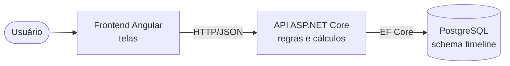
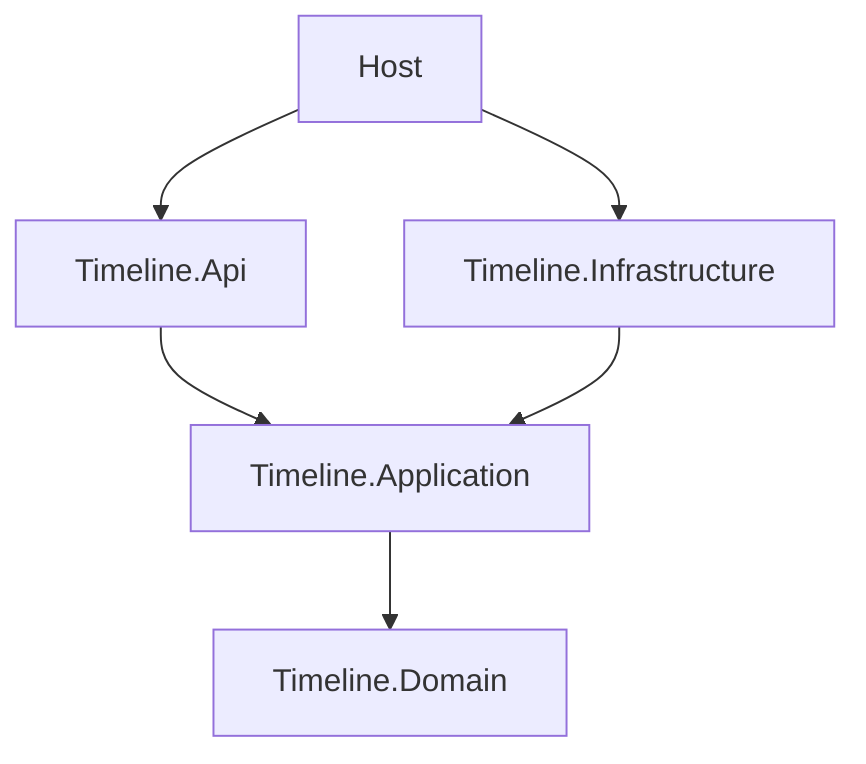
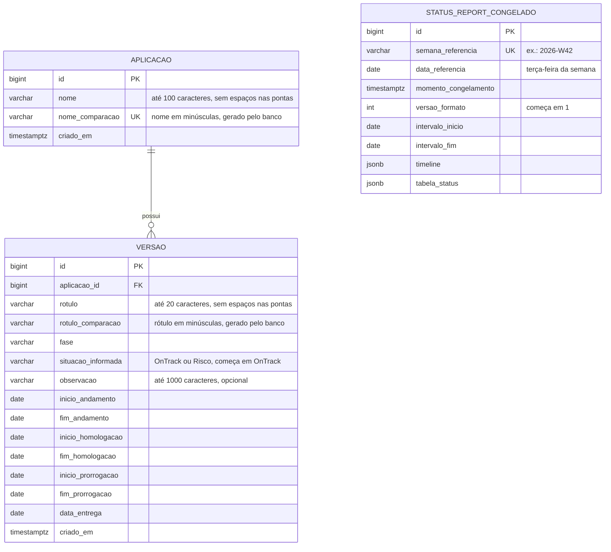

# Documento de Arquitetura
## Timeline de Entregas de Projeto

| Item | Valor |
|---|---|
| Versão | 0.19 |
| Data | 15/10/2026 |
| Status | Versão de entrega (v1.0.0) |
| Documento base | `docs/negocio/requisitos-mvp.md` (versão 0.6) |

---

> **Situação na v1.0.0:** estão construídos os degraus 1 e 2 (APIs e telas de cadastro). O cálculo e a tela da timeline, a tabela de status das aplicações e o congelamento (seções 5.4, 5.5, 5.7, 7.3 e partes das seções 6, 7.2 e 8) estão especificados, mas ainda não existem no código. Ver `docs/tarefas.md`.

## 1. Objetivo

Este documento descreve **como** o sistema é construído para atender ao `requisitos-mvp.md`: tecnologias, organização do código, modelo de dados, contrato da API, cálculo da timeline, testes, segurança e execução. Cada decisão relevante é registrada com o seu motivo (seção 13).

As regras de negócio são citadas pelos identificadores do documento de requisitos (RN, RF, RNF, CA) e não são repetidas aqui. Quando houver diferença entre este documento e o de requisitos, vale o de requisitos, e este documento deve ser corrigido.

Público: o assistente de código que implementa o sistema e a autora, que define as regras, revisa o modelo de dados e testa o comportamento pelos critérios de aceite. Cada seção começa com um resumo em linguagem simples.

---

## 2. Visão geral

**Em resumo:** o sistema tem três partes, que rodam no computador do usuário. As telas mostram e coletam informações; a API concentra todas as regras e todos os cálculos; o banco de dados guarda tudo.

- **Banco de dados** PostgreSQL.
- **API** ASP.NET Core, que concentra todas as regras de negócio, inclusive o cálculo da timeline e da tabela de status das aplicações.
- **Frontend** Angular, responsável pelas telas. Ele não decide regras de negócio: recebe da API a timeline já calculada (trechos, cores, tons, rótulos) e cuida apenas de desenhá-la na tela.



As três partes sobem juntas com um único comando, pelo Docker Compose (seção 12).

**Entrega em degraus (ADR-22):** o sistema é construído em degraus, e cada um entrega algo que já funciona. A ordem é: APIs de cadastro, telas de cadastro, API da timeline, tela da timeline, API da tabela de status das aplicações, tela da tabela de status das aplicações e, por último, o congelamento. A ordem e as estimativas estão no `tarefas.md`. Os degraus que não couberem no prazo ficam como próximos passos no README. Enquanto uma tela não existir, a informação correspondente é consultada pelas respostas da API.

---

## 3. Stack tecnológica

**Em resumo:** todas as ferramentas são gratuitas e de uso comum no mercado.

| Camada | Tecnologia | Observação |
|---|---|---|
| Backend | C# / .NET 10, ASP.NET Core 10 | Versão do SDK fixada no `global.json`. |
| Acesso a dados | Entity Framework Core com o provedor Npgsql | Migrations versionadas no repositório. |
| Banco de dados | PostgreSQL, imagem oficial | Versão fixada no `docker-compose.yml`. |
| Documentação da API | OpenAPI, gerado pela própria API, com uma página de visualização | Publicada em todos os ambientes, pois o sistema é local (RNF-01). Base para os exemplos de uso. |
| Testes do backend | xUnit, com as asserções do próprio framework, e o relógio falso da Microsoft para fixar a data atual | Sem bibliotecas de licença comercial. |
| Frontend | Angular com TypeScript e Angular Material | Versões fixadas no `package.json` e no `package-lock.json`. |
| Testes do frontend | Executor de testes padrão do Angular na versão adotada | Sem dependência extra. |
| Lint | `dotnet format` (backend) e `ng lint` com angular-eslint (frontend) | Verificam se o código segue o padrão definido. |
| Execução | Docker e Docker Compose | Banco, API e frontend com um comando. Testes e lint também rodam em container (ADR-24). |
| Controle de versão | Git e GitHub | Ver `processo-desenvolvimento.md`. |

**Restrição de custo (RNF-02):** toda ferramenta e biblioteca deve ser gratuita, com licença compatível com uso profissional futuro. A licença de cada nova dependência é verificada antes da adoção. As dependências previstas estão na seção 12.3.

**Limitação conhecida:** o Docker Desktop é gratuito para uso pessoal e em empresas pequenas, mas exige assinatura em empresas de maior porte. Para a incorporação futura (OBJ-07), há alternativas gratuitas, como o Docker Engine no WSL 2. A limitação é citada no README.

---

## 4. Organização do repositório

**Em resumo:** a estrutura de pastas é fixa e previsível. O backend é dividido em camadas com responsabilidades separadas, para que as regras de negócio não dependam de banco de dados nem de tela.

```
/
├── README.md
├── LICENSE                               # Licença MIT
├── CLAUDE.md                             # Regras para o assistente de código
├── Makefile                              # Atalhos: make install, run, test, lint
├── docker-compose.yml
├── .env.example                          # Variáveis de ambiente, com valores fictícios
├── .gitignore
├── .gitattributes                        # Quebra de linha no padrão Linux para os scripts .sh
├── .editorconfig                         # Padrão de código verificado pelo lint
├── global.json                           # Versão do SDK do .NET
├── scripts/                              # Scripts de instalação, execução, testes e lint
│   ├── install.ps1   install.sh
│   ├── run.ps1       run.sh
│   ├── test.ps1      test.sh
│   ├── lint.ps1      lint.sh
│   └── ferramentas-container.sh          # Roda dentro do container de ferramentas (ADR-31)
├── prompts/
│   └── prompts-claude-code.md            # Roteiro de prompts e registro dos pedidos ao assistente de código
├── docs/
│   ├── negocio/requisitos-mvp.md
│   ├── negocio/requisitos-negocio.md
│   ├── tecnico/arquitetura.md
│   ├── tecnico/processo-desenvolvimento.md
│   ├── tarefas.md
│   └── imagens/
├── backend/
│   ├── CLAUDE.md
│   ├── TimelineEntregas.sln
│   ├── Directory.Build.props             # Configuração comum dos projetos: .NET 10, nulos e avisos como erro
│   ├── .config/dotnet-tools.json         # Ferramenta de migrations do EF Core
│   ├── Dockerfile
│   ├── src/
│   │   ├── Host/                         # Projeto TimelineEntregas.Host: Program.cs, composição dos módulos e configuração
│   │   └── Modules/Timeline/
│   │       ├── Timeline.Domain/          # Entidades, enums, regras e cálculo da timeline
│   │       ├── Timeline.Application/     # Casos de uso, DTOs, validação de entrada, interfaces
│   │       ├── Timeline.Infrastructure/  # DbContext, mapeamentos, repositórios, migrations
│   │       └── Timeline.Api/             # Endpoints HTTP
│   └── tests/
│       ├── Timeline.Domain.Tests/
│       ├── Timeline.Application.Tests/
│       └── Timeline.Api.Tests/
├── frontend/
│   ├── CLAUDE.md
│   ├── Dockerfile
│   ├── nginx.conf                        # Servidor das telas e repasse das chamadas à API
│   ├── proxy.conf.json                   # Repasse de /api para a API durante o desenvolvimento
│   └── (workspace Angular)
└── http/
    └── exemplos.http                     # Requisições de exemplo executáveis
```

O backend segue o modelo de **monólito modular**: uma única aplicação, organizada em módulos isolados, cada um com camadas próprias e um schema próprio no banco. Nesta versão existe um único módulo, **Timeline**, o que permite integrá-lo futuramente a um sistema maior que siga o mesmo padrão (OBJ-07).

**Regras de dependência entre camadas**



- `Domain` não depende de nenhuma outra camada nem de frameworks de infraestrutura.
- `Application` conhece apenas o `Domain` e define as interfaces (por exemplo, de repositórios) que a `Infrastructure` implementa.
- `Api` conhece apenas a `Application`.
- O `Host` faz a composição (injeção de dependências) e é o único ponto que conhece todas as camadas.

---

## 5. Domínio

**Em resumo:** as regras de negócio ficam numa camada própria, escrita com os mesmos nomes do glossário. Nenhuma tela, endpoint ou consulta ao banco consegue gravar dados que violem essas regras.

### 5.1 Linguagem do domínio

Os nomes no código seguem o glossário do `requisitos-mvp.md`. Termos de domínio ficam em português, sem acentos; termos técnicos, em inglês (ex.: `Aplicacao`, `Versao`, `StatusReportCongelado`, `AplicacaoRepository`, `CalculadoraTimeline`).

| Termo do glossário | Nome no código |
|---|---|
| Aplicação | `Aplicacao` |
| Versão | `Versao` |
| Fase | `Fase` |
| Etapa | `Etapa` |
| Grupo visual | `GrupoVisual` |
| Situação | `Situacao` |
| Status report congelado | `StatusReportCongelado` |
| Semana de referência | `SemanaReferencia` |
| Data de referência | `DataReferencia` |
| Momento do congelamento | `MomentoCongelamento` |

### 5.2 Enumerações

| Enum | Valores | Regra |
|---|---|---|
| `Fase` | Backlog, Analise, Desenvolvimento, Testes, Homologacao, Producao | RN-05 |
| `Etapa` | Andamento, Homologacao, Prorrogacao | Glossário, RN-14 |
| `GrupoVisual` | NaoIniciado, EmAndamento, EmHomologacao, HomologacaoProrrogada, EmProducao | RN-06 |
| `Situacao` | NaoIniciado, OnTrack, Risco, Entregue | RN-21 |
| `Tom` | Forte, Claro | RN-25 |

### 5.3 Regras garantidas pela entidade `Versao`

A entidade `Versao` só muda por métodos que validam as regras antes de alterar qualquer dado. Se uma regra for violada, nada é alterado e o método informa o motivo, com a mensagem em português prevista no critério de aceite correspondente.

| Operação | Regras verificadas | Critérios de aceite |
|---|---|---|
| `AlterarDatas` | Recebe **todas** as sete datas de uma vez. As cinco do ciclo vêm todas preenchidas ou todas vazias (RN-09); a prorrogação, as duas ou nenhuma; a ordem cronológica é respeitada (RN-10); a prorrogação só existe com as cinco datas do ciclo (RN-09); uma prorrogação nova só pode ser registrada em Homologação, e a já registrada pode ser alterada ou removida também em Produção (RN-24); remover as datas só é permitido em Backlog (RN-07); em Produção, a data de entrega não pode passar da data atual (RN-07). Se qualquer verificação falhar, nenhuma data é alterada. | CA-05, CA-20, CA-25, CA-32, CA-35, CA-36, CA-42 |
| `AlterarFase` | Sentido das fases (RN-08): livre entre Backlog e Testes; para a frente, qualquer fase seguinte, sem passar pelas intermediárias; sem retorno a partir de Homologação; nenhuma mudança a partir de Produção. Sair do Backlog exige as datas (RN-07); entrar em Produção exige data de entrega igual ou anterior à data atual (RN-07). Ao sair do Backlog, a situação informada volta a On track (RN-21). | CA-06, CA-13, CA-39, CA-40 |
| `AlterarSituacao` | Só aceita On track ou Risco, e só fora de Backlog e de Produção (RN-21, RF-10). | — |
| `AlterarObservacao` | Texto livre, com limite de tamanho (seção 6). | CA-24 |
| `Renomear` | Rótulo obrigatório, guardado sem os espaços das pontas; a unicidade na aplicação, sem diferença entre maiúsculas e minúsculas, é verificada na `Application` e garantida no banco (RN-02, seção 6). | CA-34 |

A situação exibida é calculada: Não iniciado em Backlog, Entregue em Produção e, nas demais fases, o valor informado pelo usuário (RN-21). Uma versão nasce com a situação informada On track, que só passa a valer quando ela sai do Backlog.

A `Aplicacao` segue a mesma ideia: o nome é obrigatório, guardado sem os espaços das pontas e comparado sem diferença entre maiúsculas e minúsculas (RN-01, CA-33).

As sete datas trafegam juntas no registro `DatasVersao`, recebido por `AlterarDatas`. Os erros de formato da entrada (nome ou rótulo vazio ou longo demais, observação longa demais, situação ou fase com valor desconhecido: MSG-01, 02, 05, 06, 09, 10 e 26) são recusados antes, pela `Application` (seção 7.5); no `Domain`, esses casos só disparam uma proteção técnica, que nunca chega ao usuário (ADR-33).

**Como uma regra violada é informada (ADR-26).** O método lança uma exceção de regra de negócio (`RegraNegocioException`) com as mensagens do catálogo (seção 7.6) de **todas** as regras violadas naquela operação. Por exemplo, um salvamento com duas datas fora de ordem devolve as duas mensagens. A API converte essa exceção em erro 422.

### 5.4 Cálculo da timeline e da tabela de status das aplicações

**Em resumo:** o cálculo é feito por funções que recebem os dados e a data atual e devolvem o resultado pronto, sem acessar banco, relógio ou rede. Isso permite testar todas as regras de desenho com testes automáticos rápidos.

A `CalculadoraTimeline` (no `Domain`) recebe as aplicações com suas versões, a data atual e o intervalo de meses, e devolve a timeline calculada (formato na seção 7.3). Os passos:

1. **Ordem** das aplicações e das versões (RN-03), com desempate pela ordem de cadastro.
2. **Versões sem datas** vão para a lista "Sem previsão" da aplicação, com rótulo "vX (TBD)" (RN-13).
3. **Trechos de cada versão com datas:**
   - Análise, Desenvolvimento, Testes e Homologação: uma etapa por par de datas (andamento, homologação e, se houver, prorrogação), com o grupo visual da etapa (RN-06, RN-14), linhas pontilhadas nos intervalos e o marco de entrega.
   - Produção: as mesmas etapas, todas no grupo Em produção e em tom forte, com os intervalos pontilhados (RN-15).
   - Backlog: um único trecho contínuo, do início do andamento até a data de entrega, e o marco, tudo no grupo Não iniciado e em tom claro (RN-16).
4. **Realizado e previsto (RN-25):** cada etapa e o marco são divididos pela data atual. O dia atual conta como realizado. Os intervalos pontilhados não são divididos.
5. **Corte pelo intervalo de meses (RN-20):** trechos que começam ou terminam fora do intervalo são cortados na borda e marcados como cortados; versões inteiramente fora são omitidas; aplicações sem nada a mostrar são omitidas.
6. **Rótulo** com a data de entrega no formato dd/mm/aaaa (RN-18).
7. **Mensagem** quando nenhuma versão aparece, com os dois textos da RN-20.

A `CalculadoraTabelaStatus` devolve as linhas da tabela de status das aplicações (uma por versão, ou "Nenhuma versão cadastrada", conforme RN-01) e os contadores pela versão mais avançada de cada aplicação (RN-23). O intervalo de meses não afeta a tabela (RN-20).

**Divisão de responsabilidades com o frontend.** A API decide tudo o que é regra de negócio: trechos, cores, tons, cortes, ordem, rótulos e mensagens. O frontend decide apenas o que depende do tamanho da tela: a posição em pixels, a distribuição das versões em sub-linhas e a posição do rótulo. Isso porque a sobreposição entre versões considera a largura do rótulo (RN-14), que só é conhecida na tela, e porque a timeline se ajusta ao tamanho da tela (RNF-04). A regra de distribuição em sub-linhas é a da RN-14: seguindo a ordem recebida da API, cada versão ocupa a primeira sub-linha em que não se sobrepõe a nenhuma outra.

### 5.5 Datas no eixo da timeline

Cada data corresponde a um ponto no eixo, no **início do dia**. Assim, uma etapa que termina em 13/10 e outra que começa em 13/10 se encostam sem se sobrepor (RN-10 permite datas iguais). A divisão entre realizado e previsto, e a linha da data atual (RN-19), ficam no **fim do dia atual**, para que o dia atual conte como realizado (RN-25). O intervalo de meses vai do início do primeiro dia do mês inicial ao fim do último dia do mês final.

**Representação no JSON (ADR-27).** Toda data de trecho no JSON é um ponto no início do dia. Por isso, a divisão entre realizado e previsto, que fica no fim do dia atual, é escrita como o **dia seguinte à data atual**. Exemplo do CA-02, com data atual 15/10/2026: o vermelho forte vai de `2026-10-13` a `2026-10-16` e o vermelho claro, de `2026-10-16` a `2026-10-23`. O texto do critério ("vermelho forte de 13/10 a 15/10") deve ser lido como "até o dia 15/10, inclusive". Os testes seguem esta convenção.

**Casos de borda do eixo**

- Uma etapa que termina até o dia seguinte à data atual fica inteira em tom forte; uma etapa que começa nesse dia ou depois fica inteira em tom claro.
- O marco de entrega fica em tom forte quando a data de entrega é igual ou anterior à data atual (RN-25).
- Uma etapa com início igual ao fim, permitida pela RN-10, tem duração zero no eixo. A API a devolve normalmente, e a tela a desenha com uma largura mínima visível.
- Um intervalo de duração zero (ex.: fim da homologação igual ao início da prorrogação) não é devolvido, porque não há linha pontilhada a desenhar.

### 5.6 Data atual e fuso horário

Nenhuma classe lê o relógio diretamente. A data atual vem da abstração `TimeProvider` do .NET, registrada na injeção de dependências; nos testes, ela é fixada, para que o resultado não dependa do dia em que os testes rodam. As operações da `Versao` que dependem da data atual (`AlterarDatas` e `AlterarFase`) recebem o `TimeProvider` como parâmetro, entregue pela `Application` (ADR-33).

A data atual é a do computador do usuário (RN-19). Como a API roda dentro de um container, cujo relógio usa o fuso UTC por padrão, o fuso é configurado pela variável `TZ` do `.env` (padrão `America/Sao_Paulo`). Sem isso, entre 21h e meia-noite a API consideraria o dia seguinte. A imagem da API deve conter os dados de fuso horário.

### 5.7 Semanas e congelamento

- A semana de referência segue o padrão ISO 8601 (RN-28), calculada com a classe `ISOWeek` do próprio .NET, sem biblioteca extra. É gravada no formato `2026-W42` e exibida como "Semana 42/2026" (RNF-03).
- A data de referência é a terça-feira da semana (RN-27).
- Ao congelar, a API calcula a timeline e a tabela de status das aplicações **usando a data de referência como data atual** e o intervalo de meses selecionado; ao recongelar uma semana, atual ou anterior, usa o intervalo de meses do congelado original (RN-28).
- O resultado calculado é gravado tal como é devolvido nas consultas (seção 7.3). Consultar um congelado nunca recalcula nada (RN-29).
- Cada congelado registra a versão do formato da timeline e da tabela (`versao_formato`, começando em 1), para que congelados antigos continuem legíveis se o formato evoluir (ADR-28).
- O Histórico de Status Reports vai da primeira semana congelada até a semana atual; enquanto nenhuma semana tiver sido congelada, contém apenas a semana atual (RN-30, CA-41). Cada semana da lista informa se pode ser aberta, congelada ou congelada novamente, para que a tela não precise decidir essas regras.

---

## 6. Modelo de dados

**Em resumo:** três tabelas no schema `timeline`. As regras mais importantes de datas também são garantidas pelo próprio banco, como segunda proteção. Esta seção é a principal para revisão da autora.



**Observações sobre o modelo**

- **Identificadores:** inteiros gerados pelo banco (`bigint identity`). A ordem dos identificadores é a ordem de cadastro, usada como desempate na RN-03.
- **Data de cadastro:** `criado_em` é preenchida pelo banco (`now()`) e existe só na tabela, sem aparecer no `Domain` (ADR-34). As colunas `nome_comparacao` e `rotulo_comparacao` também ficam só no banco.
- **Unicidade (ADR-23):** a comparação de nomes e rótulos não diferencia maiúsculas de minúsculas (RN-01, RN-02). Por isso, o banco gera as colunas `nome_comparacao` e `rotulo_comparacao`, com o texto em minúsculas, e a unicidade é garantida sobre elas: `nome_comparacao` é único, e `(aplicacao_id, rotulo_comparacao)` é único. Os espaços das pontas são retirados pela `Application` antes de gravar. `semana_referencia` é única (RN-28).
- **Fase e situação** são gravadas como texto (ex.: `Homologacao`, `OnTrack`), com restrição `CHECK` dos valores possíveis, para que o banco seja legível em consultas diretas. A situação Não iniciado e a Entregue não são gravadas, porque são calculadas pela fase (RN-21). A `situacao_informada` está sempre preenchida e começa em `OnTrack`.
- **Restrições `CHECK` de datas**, que repetem no banco as regras do domínio:
  - as cinco datas do ciclo são todas nulas ou todas preenchidas (RN-09);
  - as duas datas da prorrogação são ambas nulas ou ambas preenchidas (RN-09);
  - a prorrogação só é preenchida quando as cinco datas do ciclo estão preenchidas (RN-09);
  - a ordem cronológica da RN-10, entre as datas preenchidas;
  - uma versão sem datas está em Backlog (RN-07);
  - nome da aplicação e rótulo da versão não são vazios e não têm espaços nas pontas (RN-01, RN-02), como segunda proteção da `Application` (T-05).
- **Exclusão (RN-04):** apagar uma aplicação apaga suas versões (`ON DELETE CASCADE`). A tabela `status_report_congelado` não tem ligação com as outras, por isso os congelados continuam intactos (CA-38).
- **Congelado (RN-27):** as colunas `timeline` e `tabela_status` guardam, em JSON, exatamente o resultado devolvido pela API no momento do congelamento. Recongelar uma semana substitui a linha existente por completo (RN-28).
- **Nomes** de tabelas e colunas em snake_case, em português, sem acentos. A tabela de histórico de migrations do EF Core também fica no schema `timeline`.
- **Limites de tamanho:** nome até 100, rótulo até 20 e observação até 1000 caracteres, aprovados pela autora.

---

## 7. Contrato da API

**Em resumo:** a API é a "porta" pela qual as telas conversam com as regras. Cada operação tem uma entrada e uma saída bem definidas, documentadas automaticamente.

### 7.1 Convenções

- REST com JSON; rotas sob `/api`.
- Entradas e saídas por DTOs (records) específicos de cada operação; entidades de domínio nunca são expostas diretamente.
- Datas no JSON em ISO 8601 (`2026-10-23`); a formatação dd/mm/aaaa e "Semana 42/2026" é feita pelo frontend (RNF-03), exceto o rótulo da versão, que já vem pronto (RN-18).
- Endpoints no estilo Minimal APIs do ASP.NET Core, agrupados por assunto em classes como `AplicacaoEndpoints` e `VersaoEndpoints` (ADR-29).
- Documentação OpenAPI gerada pela própria API, publicada em todos os ambientes, com uma página de visualização (ADR-30); exemplos executáveis em `http/exemplos.http`.

### 7.2 Endpoints

| Método | Rota | Descrição | Ref. |
|---|---|---|---|
| GET | `/api/aplicacoes` | Lista de aplicações, cada uma com o resumo das suas versões (id, rótulo, fase, situação e data de entrega, na ordem de cadastro) | RF-01, RF-03 |
| POST | `/api/aplicacoes` | Cadastra aplicação | RF-01 |
| PUT | `/api/aplicacoes/{id}` | Renomeia aplicação | RF-01 |
| DELETE | `/api/aplicacoes/{id}` | Exclui aplicação e suas versões | RF-01, RN-04 |
| POST | `/api/aplicacoes/{id}/versoes` | Cadastra versão, só com o rótulo | RF-03, RN-02 |
| GET | `/api/versoes/{id}` | Detalha versão, com todas as datas | RF-03, RN-18 |
| PUT | `/api/versoes/{id}` | Altera rótulo, situação e observação | RF-03, RF-09, RF-10 |
| PUT | `/api/versoes/{id}/fase` | Altera a fase | RF-04 |
| PUT | `/api/versoes/{id}/datas` | Grava as sete datas de uma vez, incluindo a prorrogação; todas vazias removem as datas | RF-05, RF-14, RN-10 |
| PUT | `/api/versoes/{id}/completo` | Grava de uma vez rótulo, situação, observação, fase e as sete datas, tudo ou nada; é o salvamento da tela da versão (ADR-39) | RF-03 a RF-05, RF-09, RF-10, RF-14, RN-07, RN-10 |
| DELETE | `/api/versoes/{id}` | Exclui versão | RF-03, RN-04 |
| GET | `/api/timeline?inicio=AAAA-MM&fim=AAAA-MM` | Timeline calculada; sem parâmetros, o semestre atual | RF-11, RF-12 |
| GET | `/api/tabela-status` | Tabela de status das aplicações e contadores | RF-13 |
| GET | `/api/historico` | Lista de semanas do Histórico de Status Reports | RF-16, RN-30 |
| GET | `/api/historico/{semana}` | Status report congelado da semana (ex.: `2026-W41`) | RF-17 |
| POST | `/api/historico/{semana}/congelar` | Congela a semana atual ou recongela uma semana já congelada | RF-15, RN-27, RN-28 |

**Congelar:** o corpo informa o intervalo de meses (usado só no primeiro congelamento) e `confirmarSubstituicao`. Se a semana já tiver congelado e a confirmação não vier, a API responde 409, e o frontend pede a confirmação ao usuário (RN-28, CA-11). Semanas anteriores sem congelado, e semanas futuras, são recusadas com 422 (RN-28, CA-30).

### 7.3 Formato da timeline

A mesma estrutura é devolvida por `GET /api/timeline` e gravada no congelado. Exemplo resumido, com a versão do CA-02:

```json
{
  "dataAtual": "2026-10-15",
  "intervalo": { "inicio": "2026-07", "fim": "2026-12" },
  "mensagem": null,
  "aplicacoes": [
    {
      "aplicacaoId": 1,
      "nome": "Alfa",
      "versoes": [
        {
          "versaoId": 3,
          "rotulo": "v1 (28/10/2026)",
          "fase": "Homologacao",
          "trechos": [
            { "tipo": "Etapa", "etapa": "Andamento", "grupoVisual": "EmAndamento", "tom": "Forte", "inicio": "2026-09-01", "fim": "2026-09-25", "cortadoNoInicio": false, "cortadoNoFim": false },
            { "tipo": "Intervalo", "inicio": "2026-09-25", "fim": "2026-10-01" },
            { "tipo": "Etapa", "etapa": "Homologacao", "grupoVisual": "EmHomologacao", "tom": "Forte", "inicio": "2026-10-01", "fim": "2026-10-13", "cortadoNoInicio": false, "cortadoNoFim": false },
            { "tipo": "Etapa", "etapa": "Prorrogacao", "grupoVisual": "HomologacaoProrrogada", "tom": "Forte", "inicio": "2026-10-13", "fim": "2026-10-16", "cortadoNoInicio": false, "cortadoNoFim": false },
            { "tipo": "Etapa", "etapa": "Prorrogacao", "grupoVisual": "HomologacaoProrrogada", "tom": "Claro", "inicio": "2026-10-16", "fim": "2026-10-23", "cortadoNoInicio": false, "cortadoNoFim": false },
            { "tipo": "Intervalo", "inicio": "2026-10-23", "fim": "2026-10-28" }
          ],
          "marcoEntrega": { "data": "2026-10-28", "grupoVisual": "EmProducao", "tom": "Claro", "visivel": true }
        }
      ],
      "semPrevisao": [ { "versaoId": 5, "rotulo": "v1.2 (TBD)" } ]
    }
  ]
}
```

- `tipo` pode ser `Etapa`, `Intervalo` (linha pontilhada) ou `Continuo` (barra de uma versão em Backlog).
- As datas seguem a convenção da seção 5.5: no exemplo, a data atual é 15/10/2026, e a divisão entre o vermelho forte e o vermelho claro aparece em `2026-10-16`.
- As listas `aplicacoes`, `versoes` e `semPrevisao` já vêm na ordem da RN-03.
- `mensagem` traz um dos textos da RN-20 quando nenhuma versão aparece; nesse caso, `aplicacoes` vem vazia.

A tabela de status das aplicações segue a mesma ideia: `contadores` (total e os quatro grupos da RN-23) e `linhas` (aplicação, versão, fase, situação, data de entrega e observação), já na ordem da RN-03.

### 7.4 Erros

Erros seguem o formato padrão **Problem Details** (RFC 9457), nativo do ASP.NET Core, sempre com mensagem em português e clara para o usuário (RNF-03). Todas as mensagens vêm do catálogo da seção 7.6, que os testes usam como referência.

| Situação | Status |
|---|---|
| Entrada inválida (formato, campo obrigatório, tamanho) | 400 |
| Recurso inexistente | 404 |
| Nome ou rótulo duplicado (RN-01, RN-02); substituição de congelado sem confirmação (RN-28) | 409 |
| Violação de regra de negócio (ex.: RN-07, RN-08, RN-10) | 422 |
| Erro inesperado | 500, sem detalhes internos na resposta |

O Problem Details traz o status, a primeira mensagem no campo `title` e a lista de **todas** as mensagens no campo `mensagens` (mesmo quando há uma só), para que as telas leiam sempre do mesmo lugar (ADR-35). Um corpo JSON ilegível (por exemplo, chave não fechada) devolve 400 com a MSG-42. O 404 de rota inexistente e o 415 de tipo de conteúdo diferente de JSON são respostas padrão do .NET, sem corpo.

Quando várias regras são violadas na mesma operação, o Problem Details traz todas as mensagens, numa lista (ADR-26). Uma duplicidade detectada pelo próprio banco (por exemplo, dois cadastros simultâneos com o mesmo nome) também é devolvida como 409, com a mensagem do catálogo.

### 7.5 Validação

Em dois níveis: o formato da entrada (campos obrigatórios, tamanhos, datas válidas) é validado na `Application`, com os recursos nativos do .NET; as regras de negócio são garantidas pelo `Domain` (seção 5.3) e, como segunda proteção, pelas restrições do banco (seção 6).

### 7.6 Catálogo de mensagens

**Em resumo:** todas as mensagens que a API devolve ao usuário, com o texto exato. Os testes conferem estes textos, e as telas os exibem sem alteração. O catálogo foi revisado e aprovado pela autora (seção 14); uma mensagem nova ou alterada entra primeiro aqui, com a aprovação dela.

**Aplicações**

| ID | Situação | Mensagem | Status | Ref. |
|---|---|---|---|---|
| MSG-01 | Nome não informado | "Informe o nome da aplicação." | 400 | RN-01 |
| MSG-02 | Nome com mais de 100 caracteres | "O nome da aplicação deve ter no máximo 100 caracteres." | 400 | Seção 6 |
| MSG-03 | Nome já existente | "Já existe uma aplicação com esse nome." | 409 | RN-01, CA-33 |
| MSG-04 | Aplicação inexistente | "Aplicação não encontrada." | 404 | — |

**Versões: rótulo, situação e observação**

| ID | Situação | Mensagem | Status | Ref. |
|---|---|---|---|---|
| MSG-05 | Rótulo não informado | "Informe o rótulo da versão." | 400 | RN-02 |
| MSG-06 | Rótulo com mais de 20 caracteres | "O rótulo da versão deve ter no máximo 20 caracteres." | 400 | Seção 6 |
| MSG-07 | Rótulo já existente na aplicação | "Já existe uma versão com esse rótulo na aplicação." | 409 | RN-02, CA-34 |
| MSG-08 | Versão inexistente | "Versão não encontrada." | 404 | — |
| MSG-09 | Observação com mais de 1000 caracteres | "A observação deve ter no máximo 1000 caracteres." | 400 | RN-22 |
| MSG-10 | Situação com valor desconhecido | "Situação inválida. Use On track ou Risco." | 400 | RN-21 |
| MSG-11 | Situação alterada em Backlog ou Produção | "A situação só pode ser alterada em versões em Análise, Desenvolvimento, Testes ou Homologação." | 422 | RN-21 |
| MSG-43 | Versão em Risco sem observação | "Informe a observação quando a situação for Risco." | 422 | RN-22 |

**Datas**

| ID | Situação | Mensagem | Status | Ref. |
|---|---|---|---|---|
| MSG-12 | Data em formato inválido | "Data inválida. Use o formato AAAA-MM-DD." | 400 | — |
| MSG-13 | Datas do ciclo informadas em parte | "As datas de andamento, de homologação e de entrega devem ser informadas em conjunto." | 422 | RN-09, CA-25 |
| MSG-14 | Só uma das datas da prorrogação informada | "O início e o fim da prorrogação devem ser informados em conjunto." | 422 | RN-24 |
| MSG-15 | Prorrogação sem as datas do ciclo | "Informe as datas de andamento, de homologação e de entrega antes de registrar a prorrogação." | 422 | RN-09 |
| MSG-16 | Início do andamento depois do fim do andamento | "O início do andamento não pode ser posterior ao fim do andamento." | 422 | RN-10 |
| MSG-17 | Fim do andamento depois do início da homologação | "O fim do andamento não pode ser posterior ao início da homologação." | 422 | RN-10, CA-05 |
| MSG-18 | Início da homologação depois do fim da homologação | "O início da homologação não pode ser posterior ao fim da homologação." | 422 | RN-10 |
| MSG-19 | Fim da homologação depois do início da prorrogação | "O fim da homologação não pode ser posterior ao início da prorrogação." | 422 | RN-10 |
| MSG-20 | Início da prorrogação depois do fim da prorrogação | "O início da prorrogação não pode ser posterior ao fim da prorrogação." | 422 | RN-10 |
| MSG-21 | Fim da prorrogação depois da data de entrega | "O fim da prorrogação não pode ser posterior à data de entrega." | 422 | RN-10, CA-32 |
| MSG-22 | Sem prorrogação: fim da homologação depois da data de entrega | "O fim da homologação não pode ser posterior à data de entrega." | 422 | RN-10 |
| MSG-23 | Nova prorrogação fora da Homologação | "A prorrogação só pode ser registrada para versões em Homologação." | 422 | RN-24, CA-36, CA-42 |
| MSG-24 | Remoção das datas fora do Backlog | "Para remover as datas, mude antes a fase da versão para Backlog." | 422 | RN-07, CA-20 |
| MSG-25 | Data de entrega futura em Produção | "Em Produção, a data de entrega não pode ser posterior à data atual." | 422 | RN-07 |

**Fases**

| ID | Situação | Mensagem | Status | Ref. |
|---|---|---|---|---|
| MSG-26 | Fase com valor desconhecido | "Fase inválida." | 400 | RN-05 |
| MSG-27 | Retorno a partir de Homologação | "Uma versão em Homologação não retorna a fases anteriores. Para estender o prazo, altere o fim da homologação ou registre uma prorrogação." | 422 | RN-08, CA-06 |
| MSG-28 | Saída do Backlog sem datas | "Informe as datas da versão antes de iniciá-la." | 422 | RN-07, CA-13 |
| MSG-29 | Produção com data de entrega futura | "Para passar para Produção, a data de entrega deve ser igual ou anterior à data atual." | 422 | RN-07, CA-39 |
| MSG-30 | Mudança de fase a partir de Produção | "Uma versão em Produção não muda mais de fase." | 422 | RN-08 |

**Timeline e tabela de status das aplicações**

| ID | Situação | Mensagem | Status | Ref. |
|---|---|---|---|---|
| MSG-31 | Mês em formato inválido | "Mês inválido. Use o formato AAAA-MM." | 400 | RN-20 |
| MSG-32 | Mês inicial depois do mês final | "O mês inicial não pode ser posterior ao mês final." | 400 | RN-20 |
| MSG-33 | Timeline sem nenhuma versão | "Nenhuma versão cadastrada para as aplicações." | — (campo `mensagem`) | RN-20, CA-29 |
| MSG-34 | Timeline sem versões no intervalo | "Nenhuma versão no período selecionado. Altere o intervalo de meses." | — (campo `mensagem`) | RN-20, CA-28 |
| MSG-35 | Linha de aplicação sem versões na tabela | "Nenhuma versão cadastrada" | — (linha da tabela) | RN-01, CA-14 |

**Congelamento e Histórico de Status Reports**

| ID | Situação | Mensagem | Status | Ref. |
|---|---|---|---|---|
| MSG-36 | Semana em formato inválido | "Semana inválida. Use o formato AAAA-Wnn (ex.: 2026-W42)." | 400 | RN-28 |
| MSG-37 | Substituição sem confirmação | "Esta semana já tem um status report congelado. Confirme para substituí-lo." | 409 | RN-28, CA-11 |
| MSG-38 | Semana anterior não congelada | "Uma semana anterior que não foi congelada não pode ser congelada depois." | 422 | RN-28, CA-30 |
| MSG-39 | Semana futura | "Não é possível congelar uma semana futura." | 422 | RN-28 |
| MSG-40 | Abrir semana sem congelado | "Esta semana não tem status report congelado." | 404 | RN-30, CA-30 |

**Geral**

| ID | Situação | Mensagem | Status | Ref. |
|---|---|---|---|---|
| MSG-41 | Erro inesperado | "Ocorreu um erro inesperado. Tente novamente." | 500 | Seção 10 |
| MSG-42 | Corpo da requisição ilegível (JSON quebrado) | "Requisição inválida. Confira os dados enviados." | 400 | Seção 7.5 |

---

## 8. Frontend

*Implementado em degraus, conforme o `tarefas.md` (ADR-22).*

**Em resumo:** as telas são feitas com componentes prontos do Angular Material, exceto a timeline, que é um componente próprio, porque nenhuma biblioteca gratuita desenha as regras visuais do projeto.

**Telas do MVP**

| Tela | Conteúdo | Regras |
|---|---|---|
| Lista de aplicações | Cadastro, edição e exclusão de aplicações; acesso às versões | RN-01, RN-04 |
| Tela da versão | Rótulo, fase, situação, observação e as sete datas num único formulário, salvo de uma vez | RN-02, RN-05 a RN-10, RN-21, RN-22, RN-24 |
| Status report | Timeline, com o seletor de intervalo de meses, e tabela de status das aplicações, com os contadores; botão para congelar a semana | RN-13 a RN-25, RN-27 |
| Histórico de Status Reports | Lista de semanas, com as ações "Abrir", "Congelar" e "Congelar novamente" | RN-28, RN-30 |
| Status report congelado | Mesma visão do status report, somente leitura, com aviso de congelado e a data de referência | RN-29, RN-30 |

**Componente de timeline**

- Desenhado com SVG: eixo de meses, uma linha por aplicação, sub-linhas quando há sobreposição, trechos recebidos da API, marco de entrega, linha da data atual, coluna "Sem previsão" e mensagem centralizada (RN-13 a RN-20).
- Responsável apenas pelo layout: converter datas em posições, distribuir as versões em sub-linhas e posicionar os rótulos dentro das barras (seção 5.4).
- Etapas de duração zero (início igual ao fim) são desenhadas com uma largura mínima visível (seção 5.5).
- Ajusta-se à largura da tela, sem limite fixo de aplicações (RNF-04).

**Demais convenções**

- Componentes standalone; comunicação com a API por serviços dedicados.
- Locale `pt-BR`; datas dd/mm/aaaa e semanas "Semana 42/2026" (RNF-03).
- Cores dos grupos visuais, com tom forte e tom claro, definidas num único lugar do tema (RN-06, RN-25).
- Confirmações antes de excluir (RN-04) e antes de substituir um congelado (RN-28).

---

## 9. Configuração e segredos

**Em resumo:** senhas e configurações locais ficam num arquivo que nunca vai para o GitHub. O repositório traz apenas um modelo desse arquivo, com valores fictícios.

- Nenhuma credencial ou string de conexão é versionada.
- O `docker-compose.yml` lê as variáveis de um arquivo `.env`, que está no `.gitignore`. O repositório contém o `.env.example`, com os nomes das variáveis e valores fictícios: usuário, senha e nome do banco; portas do banco, da API e do frontend; fuso horário (`TZ`); carga de dados de exemplo.

  | Variável | Para quê | Valor no `.env.example` |
  |---|---|---|
  | `POSTGRES_USER` | Usuário do banco | `timeline` |
  | `POSTGRES_PASSWORD` | Senha do banco | valor fictício, a trocar localmente |
  | `POSTGRES_DB` | Nome do banco | `timeline_entregas` |
  | `DB_PORT` | Porta do banco no computador (só o próprio computador acessa). Troque se a porta já estiver em uso, por exemplo por outro PostgreSQL instalado | `5432` |
  | `DB_HOST` | Endereço do banco para a API (opcional). Padrão `localhost`; no Docker Compose, a API usa `db` | não consta (usa o padrão) |
  | `API_PORT` | Porta da API no computador | `8080` |
  | `WEB_PORT` | Porta das telas no computador | `4200` |
  | `TZ` | Fuso horário da API | `America/Sao_Paulo` |
  | `SEED_DADOS_EXEMPLO` | Carga dos dados de exemplo com o banco vazio (`true` ou `false`) | `true` |

  Os três nomes `POSTGRES_*` são os que a imagem oficial do PostgreSQL já reconhece.
- A API lê a configuração pelas variáveis de ambiente, no padrão do ASP.NET Core.
- O `.gitignore` é criado antes do primeiro commit, cobrindo .NET (`bin/`, `obj/`, `.vs/`, `*.user`), Angular e Node (`node_modules/`, `.angular/`, `dist/`), IDEs e `.env`.

---

## 10. Segurança

**Em resumo:** a referência é a lista dos dez riscos mais comuns em aplicações web (OWASP Top 10). A aplicação não usa modelos de IA.

| Risco | Medida |
|---|---|
| Injeção de SQL | Acesso a dados exclusivamente pelo EF Core, com consultas parametrizadas; SQL montado por concatenação de texto é proibido. |
| XSS (código malicioso nas telas) | Proteção nativa do Angular; é proibido contornar a sanitização ou inserir HTML a partir de dados. |
| Validação de entrada | Toda entrada da API é validada (seção 7.5). |
| Exposição de informações | Erros inesperados não devolvem stack trace nem detalhes internos. |
| Dependências vulneráveis | Verificação com `dotnet list package --vulnerable` e `npm audit`. |
| Segredos | Seção 9. |
| Origem das chamadas | O frontend e a API são servidos pela mesma origem (o servidor das telas repassa `/api` para a API), sem liberação de CORS. |

**Limitação conhecida:** não há autenticação, pois o sistema é de uso local e individual (RNF-01). A API não deve ser exposta na rede. Essa limitação aparece no README, em "Limitações e próximos passos".

---

## 11. Estratégia de testes

**Em resumo:** cada critério de aceite vira um teste automático. Os testes das regras são escritos antes do código (TDD), e um único comando roda todos eles.

| Nível | Escopo | Abordagem |
|---|---|---|
| Unitário — Domain | Regras da `Versao`, cálculo da timeline, da tabela de status das aplicações e das semanas | **TDD**: os critérios de aceite são escritos como testes antes da implementação, com a data atual fixada. |
| Unitário — Application | Casos de uso, validação de entrada, unicidade, congelamento | Testes após a implementação, com repositórios em memória: classes simples escritas no próprio projeto de teste, sem o provedor em memória do EF Core. |
| Unitário — Frontend | Distribuição em sub-linhas e conversão de datas em posições | Testes após a implementação. |
| Unitário — Api | Conversão de erros em Problem Details: status, mensagens do catálogo e erro inesperado sem detalhes internos | Testes após a implementação, no projeto `Timeline.Api.Tests`, sem pacote extra (ADR-35). As rotas em si são conferidas pela página de documentação e pelo `http/exemplos.http`. |
| Estrutura — Domain | Regra de dependência entre camadas (seção 4): o `Domain` não referencia outras camadas, pacotes nem frameworks de infraestrutura | Dois testes, criados na T-03, sem dependência extra: um lê o `.csproj` do `Domain`; o outro, as referências do código compilado. |
| Integração — API e banco | Endpoints principais com PostgreSQL real | Incremento, se houver tempo. |

**Critérios de aceite por nível**

| Nível | Critérios |
|---|---|
| Domain — regras da versão | CA-05, CA-06, CA-13, CA-20, CA-25, CA-32, CA-35, CA-36, CA-39, CA-40, CA-42 |
| Domain — timeline | CA-02, CA-03, CA-04, CA-07, CA-08, CA-09, CA-15, CA-22, CA-23, CA-27, CA-28, CA-29, CA-37 |
| Domain — tabela de status das aplicações | CA-14, CA-21, CA-24 |
| Application — cadastro e congelamento | CA-10, CA-11, CA-12, CA-26, CA-30, CA-33, CA-34, CA-38, CA-41 |
| Frontend | CA-31 |

**Casos de borda obrigatórios**

- Datas iguais nos limites da RN-10 (ex.: fim da homologação igual ao início da prorrogação).
- Data atual igual ao início ou ao fim de uma etapa; marco de entrega na própria data atual (tom forte).
- Barra cortada no início, no fim e nos dois lados do intervalo de meses; versão inteiramente fora.
- Aplicação sem versões, só com versões sem datas e só com versões fora do intervalo.
- Virada de ano: 01/01/2027 pertence à Semana 53/2026, com data de referência 29/12/2026.
- Recongelamento de semana anterior mantendo a data de referência e o intervalo de meses originais.
- Tentativas que devem falhar sem alterar nada: datas parciais, ordem inválida, prorrogação fora da Homologação, remoção de datas fora do Backlog, Produção com entrega futura.
- Etapa com início igual ao fim; intervalo de duração zero; data atual na véspera do início de uma etapa (seção 5.5).
- Nomes e rótulos que diferem só em maiúsculas ou em espaços nas pontas.
- Avanço direto de Backlog para Produção, com e sem as condições da RN-07.
- Alteração da prorrogação de uma versão em Produção (aceita) e registro de nova prorrogação em Produção (recusado).
- Histórico de Status Reports sem nenhuma semana congelada.
- Várias regras violadas no mesmo salvamento, com todas as mensagens devolvidas.

**Regras gerais:** nomes de teste descrevem o cenário e o resultado esperado e citam o critério ou a regra coberta (ex.: `CA02_HomologacaoProrrogada_DivideVermelhoNaDataAtual`); um teste existente não é alterado nem removido sem aprovação (ver `processo-desenvolvimento.md`); o script `test` roda toda a suíte.

---

## 12. Execução, empacotamento e scripts

**Em resumo:** quem baixar o projeto precisa instalar só o Git e o Docker. Com dois comandos, o sistema sobe inteiro, com dados de exemplo.

### 12.1 Docker Compose

O `docker-compose.yml` define os serviços abaixo, mais o serviço `ferramentas`, que só roda quando chamado pelos scripts `install`, `test` e `lint` (perfil `ferramentas`, ADR-31):

| Serviço | Conteúdo |
|---|---|
| `db` | PostgreSQL, versão principal 17 (ADR-32), com os dados guardados num volume do Docker. A porta fica aberta só para o próprio computador. |
| `api` | A API. Ao iniciar, aplica as migrations pendentes e, se o banco estiver vazio e a variável de carga estiver ligada, cria dados fictícios de exemplo (aplicações Alfa, Beta, Gama e Delta), com datas calculadas a partir do dia da carga, para que a timeline do semestre atual nunca apareça vazia (ADR-25). |
| `web` | As telas, compiladas com o Node.js e servidas pelo nginx, que também repassa as chamadas `/api` para a API (ADR-21, ADR-38). A porta no computador vem de `WEB_PORT` (padrão 4200). |

**Dados de exemplo** (carga quando o banco está vazio; datas em dias a partir do dia da carga, D):

| Aplicação | Versão | Fase | Situação | Andamento | Homologação | Entrega |
|---|---|---|---|---|---|---|
| Alfa | v0 | Produção | Entregue | D−110 a D−60 | D−59 a D−30 | D−20 |
| Alfa | v1 | Homologação | On track | D−40 a D−10 | D−9 a D+8 | D+10 |
| Beta | v1 | Desenvolvimento | Risco | D−15 a D+25 | D+26 a D+40 | D+45 |
| Gama | v1 | Testes | On track | D−30 a D+5 | D+6 a D+20 | D+25 |
| Delta | (nenhuma) | | | | | |

A v1 da Alfa sempre atravessa o dia da carga, e a Delta fica sem versões (CA-23). O teste `CarregarDadosDeExemploTests` simula a carga em cada dia de um ano e confere que todas as versões respeitam as regras (ADR-37).

**Desenvolvimento:** o banco roda pelo Docker Compose; a API e o frontend rodam diretamente pelo `dotnet` e pelo `npm`, com recarga automática a cada alteração. O frontend repassa as chamadas `/api` para a API pelo `proxy.conf.json`. No computador da autora, o SDK do .NET está instalado (T-01), e o assistente usa os comandos `dotnet` diretamente.

### 12.2 Scripts e atalhos

Os mesmos quatro comandos existem em três formas: scripts `.ps1` (Windows, PowerShell), scripts `.sh` (Linux e macOS; no Windows, também pelo Git Bash) e atalhos no `Makefile`, que apenas chamam os scripts `.sh`.

| Comando | Script no Windows | Atalho | O que faz |
|---|---|---|---|
| install | `scripts\install.ps1` | `make install` | Cria o `.env` a partir do `.env.example`, se ainda não existir, e baixa as imagens e as dependências. |
| run | `scripts\run.ps1` | `make run` | Sobe banco, API e, quando houver, as telas pelo Docker Compose, e informa os endereços. |
| test | `scripts\test.ps1` | `make test` | Roda os testes do backend e, quando houver telas, do frontend, dentro de containers com as ferramentas necessárias, sem exigir o SDK instalado no computador (ADR-24). |
| lint | `scripts\lint.ps1` | `make lint` | Verifica o padrão do código do backend e, quando houver telas, do frontend, também em container (ADR-24). |

No Windows, o README indica o comando que executa o script sem alterar a política de segurança do computador (ex.: `powershell -ExecutionPolicy Bypass -File scripts\test.ps1`).

### 12.3 Dependências

- Backend: arquivos `.csproj` e `global.json`. Frontend: `package.json` e `package-lock.json`. Banco: versão da imagem no `docker-compose.yml`. Esses arquivos cumprem o papel que o `requirements.txt` e o `pyproject.toml` têm em projetos Python.
- Dependências são adicionadas exclusivamente pelas ferramentas oficiais (`dotnet add package`, `npm install`), que registram as versões nos arquivos do projeto. Versões nunca são escritas manualmente a partir de sugestões de IA.

**Dependências previstas**, aprovadas pela autora de uma vez. A licença de cada uma é conferida na instalação. Qualquer dependência fora desta lista precisa de aprovação específica.

| Dependência | Para quê | Licença |
|---|---|---|
| Entity Framework Core e o provedor Npgsql | Acesso ao PostgreSQL | MIT e PostgreSQL License |
| Ferramentas de design do EF Core e ferramenta `dotnet-ef` | Criar e aplicar as migrations | MIT |
| xUnit, executor do xUnit e SDK de testes da Microsoft | Escrever e rodar os testes | Apache 2.0 e MIT |
| Relógio falso da Microsoft (`Microsoft.Extensions.TimeProvider.Testing`) | Fixar a data atual nos testes | MIT |
| Geração do documento OpenAPI (`Microsoft.AspNetCore.OpenApi`) e página de visualização (Scalar) | Gerar a documentação da API e consultá-la no navegador (ADR-30) | MIT e MIT |
| Angular, Angular Material e angular-eslint | Telas e lint do frontend | MIT |
| Vitest e jsdom (o executor de testes do Angular 22 e um simulador de navegador, trazidos pelo gerador do projeto Angular) | Rodar os testes das telas, sem abrir navegador | MIT e MIT (conferido nos pacotes instalados, aprovado pela autora em 15/10/2026) |
| `@angular/cdk`, `eslint`, `typescript-eslint` e `@eslint/js` (instalados junto com o Angular Material e o angular-eslint) | Base dos componentes e do lint do frontend | MIT (conferido nos pacotes instalados) |

### 12.4 Empacotamento e reprodutibilidade

| Item | Como o projeto atende |
|---|---|
| Estrutura de pastas previsível | Seção 4. |
| Dependências declaradas com clareza | Seção 12.3. |
| Scripts de execução e testes | Seção 12.2. |
| Configurações sensíveis fora do repositório | Seção 9. |
| Instalação em máquina limpa | Docker Compose (12.1) e teste de instalação limpa antes da versão final (`processo-desenvolvimento.md`, checklist de release). |

---

## 13. Registro de decisões (ADR)

| ID | Decisão | Motivo | Alternativas consideradas |
|---|---|---|---|
| ADR-01 | Monólito modular, um schema por módulo | Simplicidade de execução com isolamento por assunto; permite integração futura a um sistema com o mesmo padrão (OBJ-07). | Monólito sem módulos (dificulta a integração); microsserviços (complexidade sem justificativa). |
| ADR-02 | Regras e cálculos na API; layout no frontend | Regras num único lugar e testáveis; o frontend só cuida do que depende da tela (posição, sub-linhas, rótulo). | Cálculo no frontend (regras duplicadas e difíceis de testar). |
| ADR-03 | Data atual por `TimeProvider`, com fuso configurado | Testes previsíveis e data correta no container. | Leitura direta do relógio (testes instáveis; data errada à noite). |
| ADR-04 | A aplicação não integra modelos de IA | O problema é resolvido por regras previsíveis; a IA é usada no desenvolvimento, não no produto. | Integração com modelo de linguagem (custo e complexidade sem benefício). |
| ADR-05 | Docker Compose para banco, API e telas | Um comando, em qualquer sistema operacional; apenas Git e Docker como pré-requisitos. | Instalação manual de cada parte (mais pré-requisitos e pontos de falha). |
| ADR-06 | Scripts `.ps1` e `.sh`, com `Makefile` como atalho | Comandos padronizados em todos os sistemas: `.ps1` no Windows, `.sh` e `make` em Linux e macOS. | Só comandos no README (mais erro manual); só `Makefile` (o `make` não vem instalado no Windows). |
| ADR-07 | Componente de timeline próprio, em SVG | Controle total das regras visuais; evita bibliotecas de gráfico de Gantt com licença comercial. | Bibliotecas de Gantt (licença e pouca personalização por trecho). |
| ADR-08 | Erros no padrão Problem Details | Padrão aberto, nativo do ASP.NET Core. | Formato próprio de erro. |
| ADR-09 | Dependências só pelas ferramentas oficiais | Evita versões inexistentes ou desatualizadas sugeridas por IA. | Versões escritas manualmente. |
| ADR-10 | Sem autenticação nesta versão | Uso local e individual (RNF-01). | Autenticação local (esforço sem benefício agora). |
| ADR-11 | Congelado gravado como resultado calculado, em JSON | Garante que o congelado nunca muda, mesmo que o cálculo evolua (RN-29). | Gravar os dados brutos e recalcular (o desenho mudaria com novas versões do sistema). |
| ADR-12 | Datas gravadas por uma única operação, que valida tudo antes de alterar | Atende ao "tudo ou nada" da RN-10 e permite mudar prorrogação e entrega juntas (CA-32). | Uma operação por data (alterações em cadeia seriam rejeitadas). |
| ADR-13 | Regras de datas também como restrições `CHECK` no banco | Segunda proteção contra dados inválidos; legível para quem consulta o banco. | Só validação no código. |
| ADR-14 | Identificadores inteiros gerados pelo banco | Legíveis, e a ordem coincide com a ordem de cadastro (RN-03). | UUID (menos legível; exigiria outra coluna para a ordem). |
| ADR-15 | Exclusão definitiva, em cascata | Decisão do MVP (RN-04); o arquivamento é evolução futura. | Arquivamento lógico. |
| ADR-16 | Semana no padrão ISO, com a classe `ISOWeek` | Atende à RN-28 sem biblioteca extra. | Cálculo próprio de semanas (sujeito a erro nas viradas de ano). |
| ADR-17 | xUnit e validação com recursos nativos do .NET | Gratuitos, sem dependência extra. | Bibliotecas de asserção e de validação de terceiros (algumas mudaram para licença comercial). |
| ADR-18 | Termos de domínio em português e técnicos em inglês | Código com os mesmos nomes do glossário. | Tudo em inglês (exigiria tradução dos termos de negócio). |
| ADR-19 | Licença MIT | Licença aberta mais comum; o repositório é público e não contém dados sensíveis. | Sem licença (o código não poderia ser reutilizado legalmente). |
| ADR-20 | Lint com `dotnet format` e `ng lint` | Padroniza o código com ferramentas gratuitas do próprio ecossistema. | Sem verificação automática do padrão. |
| ADR-21 | Frontend e API na mesma origem | Dispensa liberar CORS e simplifica a configuração. | API em outra porta, com CORS liberado. |
| ADR-22 | Entrega em degraus, na ordem do `tarefas.md`: cada API antes da tela correspondente e o congelamento por último | Cada degrau entrega algo que funciona; o que não couber no prazo vira próximo passo, sem comprometer a entrega. Cada API vem antes da sua tela porque concentra as regras e os testes. | Duas etapas fixas (API completa e depois telas); API e telas numa única entrega. |
| ADR-23 | Unicidade sobre colunas de comparação, em minúsculas, geradas pelo banco | Garante no próprio banco que "Alfa" e "alfa" não coexistam (RN-01, RN-02), com recursos padrão do PostgreSQL e do EF Core. | Configuração de comparação sem diferença de maiúsculas no banco (mais complexa); comparação só no código (sem a segunda proteção). |
| ADR-24 | Testes e lint executados em container | Cumpre a promessa de que bastam Git e Docker para usar e avaliar o projeto. | Exigir o SDK do .NET e o Node.js instalados. |
| ADR-25 | Dados de exemplo com datas relativas ao dia da carga | A timeline de exemplo nunca aparece vazia, qualquer que seja a data de execução. | Datas fixas (envelhecem). |
| ADR-26 | Regra violada informada por exceção, com as mensagens de todas as regras violadas | Um único caminho para os erros 422, e o usuário vê todos os problemas de uma vez. | Retorno de resultado em cada método (mais código); só a primeira mensagem. |
| ADR-27 | Datas como pontos no início do dia; divisão do realizado no dia seguinte à data atual | Convenção única para o cálculo, os testes e o desenho (RN-10, RN-25). | Datas como dias inteiros (etapas consecutivas se sobreporiam em um dia). |
| ADR-28 | Versão do formato gravada em cada congelado | Congelados antigos continuam legíveis se o formato evoluir (RN-29). | Sem versão (risco de não abrir congelados antigos). |
| ADR-29 | Endpoints no estilo Minimal APIs | Estilo atual do ASP.NET Core, com menos código. | Controllers. |
| ADR-30 | Documentação OpenAPI publicada em todos os ambientes, com página de visualização | O sistema é local (RNF-01), e quem avalia consulta a API pelo navegador. | Documentação só em desenvolvimento (invisível no Docker). |
| ADR-31 | Serviço `ferramentas` no Docker Compose (imagem do SDK do .NET, perfil `ferramentas`), usado por `install`, `test` e `lint`; o container trabalha numa cópia do código, sem `bin` e `obj` | Um só lugar define a imagem do SDK e como montar o código, igual no Windows, no Linux e no macOS (ADR-24). A cópia evita misturar arquivos de compilação do computador com os do container e arquivos de root na pasta do projeto. | `docker run` em cada script (imagem repetida em quatro scripts e caminhos diferentes por sistema); montar a pasta para escrita (mistura de arquivos e permissões). |
| ADR-32 | PostgreSQL de versão principal 17, porta publicada só para o próprio computador e configurável por `DB_PORT` | Versão estável e madura, com o volume no caminho padrão da imagem. Quem já tem outro PostgreSQL instalado (porta 5432 ocupada) só troca `DB_PORT` no `.env`. | Versão 18 (mudou o caminho do volume); porta fixa (conflita com PostgreSQL já instalado); porta aberta para a rede. |
| ADR-33 | A `Versao` recebe o `TimeProvider` como parâmetro nas operações que dependem da data atual; erros de formato são recusados na `Application`, e o `Domain` só tem uma proteção técnica para eles | A entidade continua sem dependências e sem ler o relógio (seção 5.6), e cada mensagem do catálogo tem um único lugar de origem. | Data atual como `DateOnly` vinda de fora (mais fácil de errar o fuso em cada chamada); validar formato também no `Domain` com as mensagens (mensagem em dois lugares). |
| ADR-34 | A migration é aplicada por um serviço de inicialização do `Host`, e não no `Program.cs`; a conexão é montada com as variáveis `POSTGRES_*`, `DB_PORT` e `DB_HOST`; `criado_em` e as colunas de comparação existem só no banco; as migrations geradas ficam fora da verificação de padrão do lint | O serviço roda só quando a API inicia, e não quando a ferramenta de migrations carrega o programa para criar uma migration. A conexão reaproveita as variáveis do `.env`, sem senha no código. O `Domain` continua sem conhecer o banco. O código gerado pela ferramenta não é reformatado à mão. | Migrate no `Program.cs` (a ferramenta de migrations o executaria); string de conexão única em outra variável (senha repetida no `.env`); `criado_em` na entidade (campo sem regra de negócio no `Domain`). |
| ADR-35 | Padrão das APIs de cadastro (T-06): uma classe por caso de uso na `Application`, que lança exceções de erro esperado (entrada inválida, não encontrado, conflito) com as mensagens do catálogo; um único tratador de erros na `Api` converte essas exceções, a `RegraNegocioException` e qualquer erro inesperado em Problem Details, com o `title` e a lista `mensagens`; `ThrowOnBadRequest` ligado, para o JSON ilegível devolver a MSG-42; a ordem das listas é feita na `Application`; os casos de uso são registrados pela própria `Api` (a `Application` não depende de pacote de injeção de dependências); a `Api` publica o OpenAPI e a página Scalar; novo projeto de testes `Timeline.Api.Tests`, sem pacote extra, para o tratador de erros; `API_PORT` define a porta, e a API só aceita chamadas do próprio computador | Um só caminho para os erros, com o texto exato do catálogo, que serve de modelo às próximas APIs; erro inesperado nunca mostra detalhes internos (seção 10); a `Application` continua sem pacotes. | Tratar erros em cada endpoint (repetição); erros como valores de retorno (mais código em cada caso de uso); testes de integração com servidor em memória (exigem pacote fora da lista aprovada). |
| ADR-36 | Padrão das APIs de versões (T-07): datas, fase e situação chegam como texto e são convertidas na `Application`, que devolve a MSG-12, a MSG-26 ou a MSG-10 (se o .NET convertesse, um valor torto daria a MSG-42); fase e situação saem como texto (`Homologacao`, `OnTrack`); a situação enviada igual à atual não conta como alteração, e vazia mantém a atual; observação vazia remove a observação; `/datas` sem corpo é recusado com a MSG-42, para não apagar as datas por engano; a regra que pode falhar roda antes de qualquer alteração; o `TimeProvider` do sistema é registrado pela `Api`, com o fuso do ambiente (`TZ`); a lista de aplicações traz o resumo das versões, e `ListarAplicacoes` usa os dois repositórios | Respostas sempre com as mensagens do catálogo, e a data atual vinda de um relógio injetado, como a seção 5.6 pede; a tela da T-10 recebe a lista já com as versões. | Converter datas e fase pelo próprio .NET (mensagem genérica no lugar da MSG-12 e da MSG-26); um endpoint à parte só para listar versões; deixar a lista com versões para a T-10. |
| ADR-37 | A carga dos dados de exemplo é um caso de uso da `Application` (`CarregarDadosDeExemplo`), chamado por um serviço de inicialização do `Host` depois das migrations; a imagem da API é construída em duas etapas (SDK e execução) com o pacote `tzdata` e o contexto na raiz do projeto | O caso de uso usa os repositórios e o `TimeProvider`, então o teste roda sem banco, simulando a carga em cada dia de um ano (ADR-25). A imagem final leva só o necessário para executar. | Carga por SQL ou por script (sem testar as regras das datas); imagem única com o SDK (maior). |
| ADR-38 | As telas rodam no Docker em duas etapas: compilação com a imagem oficial do Node.js (`node:24-slim`) e execução no nginx (`nginx:stable-alpine`), que repassa `/api` para o serviço `api`. Testes e lint do frontend rodam no serviço `ferramentas-web` (perfil `ferramentas`), com a imagem do Node.js e `npm ci`, sem exigir o Node.js no computador. | Mantém a promessa de que bastam Git e Docker (ADR-24) e a mesma origem para telas e API (ADR-21). As imagens são oficiais e gratuitas; nenhuma dependência nova no projeto. | Servir as telas com o servidor de desenvolvimento do Angular; exigir o Node.js instalado para testar. |
| ADR-39 | A tela da versão tem um único botão Salvar, que chama `PUT /api/versoes/{id}/completo` (T-10). A operação recebe rótulo, situação, observação, fase e as sete datas, e a `Versao.Alterar` grava tudo ou nada, restaurando o estado anterior se qualquer passo falhar. Ordem dos passos, por causa da RN-07: se a fase avança, as datas vêm antes (sair do Backlog exige datas; Produção exige a entrega até a data atual), e uma prorrogação nova vale para a fase de destino (assim, de Backlog para Homologação com prorrogação é aceito); em Risco, a observação é obrigatória (MSG-43), e a regra olha o resultado final (`Versao.AlterarDados` faz o mesmo para o `PUT /api/versoes/{id}`); nos demais casos, a fase vem antes (voltar ao Backlog libera a remoção das datas); a situação vem depois da fase, porque sair do Backlog a reinicia em On track. A resposta traz as mensagens do primeiro passo que falha. Fase e datas são obrigatórias no corpo (o bloco de datas ausente dá a MSG-42, para não apagar as datas sem querer; fase ausente ou desconhecida dá a MSG-26); situação vazia mantém a atual. As três operações separadas (`PUT /api/versoes/{id}`, `/fase` e `/datas`) continuam. | A autora pediu um só salvamento na tela. Chamar as três operações em sequência pelo frontend poderia salvar pela metade, contra o CA-32, e poria uma regra de ordem na tela, contra o `frontend/CLAUDE.md`. | Três botões, um por bloco (recusado pela autora); abas; frontend chamando as três operações numa ordem fixa. |
| ADR-40 | Padrão das telas de cadastro (T-10): rotas `/` (lista de aplicações) e `/versoes/:id` (tela da versão); cada assunto tem um serviço de acesso à API (`AplicacaoService`, `VersaoService`); os erros da API são lidos num único lugar (`mensagens` do Problem Details) e exibidos exatamente como vêm, e, sem mensagem na resposta (por exemplo, sem conexão), exibe-se a MSG-41; janelinhas do Angular Material para nome e para confirmação; datas escolhidas no seletor de datas do Angular Material (adaptador nativo, sem pacote novo), convertidas para `AAAA-MM-DD` pelos componentes locais do dia, sem passar por UTC; textos de fase e situação em um só arquivo de rótulos de exibição, sem regra; aviso rápido "Alterações salvas." depois de salvar; as datas só se escolhem no calendário (campo só de leitura, com botão "Limpar"), para que um texto digitado errado nunca apague uma data sem aviso; a Situação fica só de leitura quando a fase escolhida é Backlog ou Produção, mostrando já "Não iniciado" ou "Entregue", apenas como conveniência (a API continua validando, MSG-11); o campo Fase fica só de leitura para versão em Produção, e em Homologação só oferece Homologação e Produção (a API continua validando, MSG-27 e MSG-30); ao salvar com sucesso, a tela volta para a lista de aplicações; fase e situação em etiquetas coloridas (componente `Etiqueta`, cores no tema, RN-36); coluna "Data de entrega" na lista, em dd/mm/aaaa ou "TBD"; título "Timeline de Entregas (MVP)" e versão do sistema na barra (`versao-sistema.ts`); padrão de layout (revisão de usabilidade): conteúdo com largura máxima de 1000 px; fase e situação como etiquetas, com Risco destacado; linha da versão inteira clicável; ações destrutivas ("Excluir") em cor de alerta e afastadas das demais; blocos "Dados da versão" e "Datas" em cartões; datas em grade, uma etapa por linha com início e fim lado a lado, na ordem da RN-10; barra fixa no pé da tela da versão com o Salvar e as mensagens da API sempre à vista; barra de carregamento enquanto a API responde; limite de aviso do tamanho do pacote das telas subido para 1 MB (erro em 2 MB), porque o sistema roda só no computador local (RNF-01). | Um caminho único para erros e confirmações, reaproveitável pelas próximas telas; datas sem troca de dia por fuso; nenhuma dependência nova. | Texto de erro próprio em cada tela; converter datas com `toISOString` (muda o dia no fuso de Brasília); biblioteca de datas extra. |

---

## 14. Pontos para revisão da autora

| Ponto | Onde | Situação |
|---|---|---|
| Tabelas, colunas e restrições do banco, incluindo as colunas de comparação de nomes e rótulos e a versão do formato do congelado | Seção 6 | Aprovado na T-05 |
| Catálogo de mensagens | Seção 7.6 | Aprovado: MSG-11 e MSG-13 a MSG-30 na T-04; as demais 22 depois da T-05; MSG-42 na T-06; MSG-43 na T-10 |
| Dependências previstas | Seção 12.3 | Aprovado |
| Dados de exemplo carregados automaticamente, com datas relativas ao dia da carga | Seção 12.1 | Aprovado na T-08 |
| Limites de tamanho: nome da aplicação até 100, rótulo da versão até 20 e observação até 1000 caracteres | Seção 6 | Aprovado |

---

## 15. Histórico do documento

| Versão | Data | Descrição |
|---|---|---|
| 0.1 | 14/10/2026 | Versão inicial, baseada no modelo de datas anterior (deploys, data prevista e linha de base). |
| 0.2 | 14/10/2026 | Reescrita a partir do `requisitos-mvp.md` versão 0.5: modelo de sete datas e regras da `Versao`; cálculo da timeline e divisão de responsabilidades com o frontend; datas no eixo, fuso horário e semanas ISO; modelo de dados com restrições no banco e congelado em JSON; endpoints agrupados; telas do MVP; scripts, Makefile, lint e Docker Compose com dados de exemplo; critérios de aceite por nível de teste; decisões registradas (ADR-01 a ADR-21) e pontos para revisão da autora. |
| 0.3 | 14/10/2026 | Incluída a pasta `prompts/`, com o registro dos pedidos feitos ao assistente de código (seção 4). |
| 0.4 | 14/10/2026 | Entrega em duas etapas: API na versão 1.0 e telas na versão 1.1 (seções 2, 8, 12 e ADR-22). |
| 0.5 | 15/10/2026 | Revisão de arquitetura e alinhamento ao `requisitos-mvp.md` versão 0.6: entrega em degraus (seção 2, ADR-22); convenção das datas no JSON e casos de borda do eixo, com correção do exemplo do CA-02 (5.5, 7.3, ADR-27); avanço direto de fase e correção da prorrogação em Produção (5.3); nomes e rótulos sem diferença de maiúsculas, com colunas de comparação (5.3, 6, ADR-23); regra violada informada com todas as mensagens (5.3, 7.4, ADR-26); restrição da prorrogação sem as datas do ciclo e situação inicial (6); recongelamento da semana atual, Histórico antes do primeiro congelamento e versão do formato do congelado (5.7, 6, ADR-28); Minimal APIs e documentação OpenAPI visível (7.1, ADR-29, ADR-30); catálogo de mensagens (7.6); testes e lint em container (12.2, ADR-24); dados de exemplo com datas relativas (12.1, ADR-25); dependências previstas (12.3); `.gitattributes`, `.editorconfig`, ferramenta de migrations e repasse do frontend em desenvolvimento (4, 12.1); limitação do Docker Desktop (3); novos casos de borda e critérios CA-40 a CA-42 (11); limites de tamanho aprovados (6, 14). |
| 0.6 | 15/10/2026 | Ordem dos degraus alinhada ao `tarefas.md` versão 0.5: telas de cadastro antes da API da timeline; API e tela da tabela de status das aplicações antes do congelamento (seção 2, ADR-22). |
| 0.7 | 15/10/2026 | Dependências previstas aprovadas pela autora (seções 12.3 e 14). Corrigida a introdução do catálogo de mensagens, que o dava como aprovado antes da revisão (seção 7.6). |
| 0.8 | 15/10/2026 | Seção 4: o `prompts/prompts-claude-code.md` reúne o roteiro de prompts e o registro dos pedidos. |
| 0.9 | 15/10/2026 | Seção 9: nomes das variáveis do `.env.example` (T-02). |
| 0.10 | 15/10/2026 | T-03: `Microsoft.AspNetCore.OpenApi` nas dependências previstas (12.3); `Directory.Build.props`, nome do projeto Host e `scripts/ferramentas-container.sh` na estrutura (4); `DB_PORT` (9); teste de estrutura do `Domain` (11); serviço `ferramentas` e PostgreSQL 17 (12.1); ADR-31 e ADR-32. |
| 0.11 | 15/10/2026 | T-04: registro `DatasVersao` e origem dos erros de formato (5.3); `TimeProvider` como parâmetro das operações da `Versao` (5.6); ADR-33; MSG-11 e MSG-13 a MSG-30 aprovadas pela autora (14). |
| 0.12 | 15/10/2026 | T-05: proteção do banco contra nome e rótulo vazios ou com espaço nas pontas, e `criado_em` (seção 6); `DB_HOST` (9); modelo de dados aprovado (14); ADR-34. |
| 0.13 | 15/10/2026 | Catálogo de mensagens completo aprovado pela autora (seções 7.6 e 14). |
| 0.14 | 15/10/2026 | T-06: MSG-42 aprovada (7.6, 14); formato do Problem Details com `title` e `mensagens` e respostas padrão do .NET (7.4); projeto `Timeline.Api.Tests` (4, 11); ADR-35. O cabeçalho do documento foi corrigido para a versão do histórico. |
| 0.15 | 15/10/2026 | T-07: lista de aplicações com o resumo das versões (7.2); ADR-36. |
| 0.16 | 15/10/2026 | T-08: conjunto dos dados de exemplo (12.1); imagem Docker da API e serviço `api` (12.1); ADR-37. |
| 0.17 | 15/10/2026 | T-09: serviço `web` no Docker (nginx) e serviço `ferramentas-web` para testes e lint do frontend (12.1); ADR-38. |
| 0.18 | 15/10/2026 | T-10: operação `PUT /api/versoes/{id}/completo` (7.2), com um só salvamento na tela da versão (ADR-39); padrão das telas de cadastro (ADR-40). |
| 0.19 | 15/10/2026 | Preparação da entrega: status de versão de entrega, aviso do que está construído na v1.0.0 e dados de exemplo marcados como aprovados na seção 14. |
