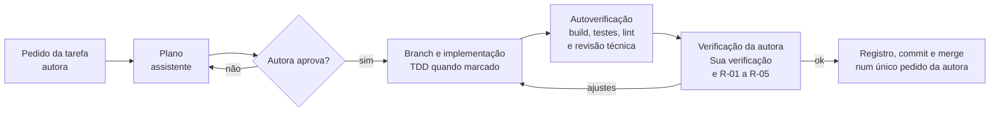

# Processo de Desenvolvimento Assistido por IA
## Timeline de Entregas de Projeto

| Item | Valor |
|---|---|
| Versão | 0.10 |
| Data | 15/10/2026 |
| Ferramenta principal | Claude Code |

---

## 1. Objetivo

Este documento define como o projeto é desenvolvido com o apoio de um assistente de código baseado em IA, o Claude Code. Ele diz quem faz o quê, como o contexto é fornecido, como cada tarefa é conduzida, como o resultado é verificado e como o processo é registrado. Os arquivos `CLAUDE.md` trazem as regras resumidas para o assistente; este documento explica o processo completo e o motivo de cada prática.

Uma característica do projeto orienta todo o processo: **a autora é analista de requisitos e não programa**. Ela domina as regras de negócio e o banco de dados, e o assistente escreve todo o código. Por isso, a revisão humana é feita pelo **comportamento do sistema**, conferido contra os critérios de aceite, e não pela leitura do código. A qualidade técnica é protegida por testes automáticos, verificações automáticas e revisões do próprio assistente. Todas são relatadas à autora em linguagem simples (seção 7).

Os termos técnicos usados aqui estão explicados na seção 15.

---

## 2. Princípios e papéis

### 2.1 Princípios

1. **A IA aumenta, não substitui.** Nenhuma entrega é aceita sem a verificação da autora. Ela decide **o que** o sistema deve fazer. O assistente decide **como** construir e deve explicar cada decisão.
2. **Contexto escrito supera contexto improvisado.** Requisitos, arquitetura e convenções ficam em documentos versionados, lidos pelo assistente, em vez de repetidos a cada pedido.
3. **Passos pequenos e verificáveis.** Cada tarefa é curta e tem uma verificação objetiva, o item "Sua verificação" do `tarefas.md`. Isso reduz erros e facilita a conferência.
4. **Planejar antes de implementar.** O assistente apresenta um plano em linguagem simples, que a autora aprova ou corrige antes de qualquer alteração.
5. **Testes como contrato.** Cada critério de aceite vira um teste automático, que o assistente não pode alterar sem aprovação. Os testes ligam as regras que a autora escreveu ao código que ela não lê.
6. **Explicar sempre.** Toda mensagem à autora diz de qual tela, regra ou documento está falando. Ela traz exemplos concretos, de preferência com os dados fictícios dos critérios de aceite (aplicações Alfa, Beta, Gama e Delta).
7. **Registro contínuo.** O processo é registrado durante o desenvolvimento, não reconstruído no final.

### 2.2 Papéis

| Atividade | Autora | Assistente |
|---|---|---|
| Regras de negócio, requisitos e critérios de aceite | Define e mantém, nos dois documentos de requisitos | Segue o `requisitos-mvp.md`. Se notar lacuna ou contradição, para e pergunta. |
| Decisões técnicas (organização do código, nomes, bibliotecas, banco) | Toma conhecimento | Decide, seguindo o `arquitetura.md`. Uma decisão nova é apresentada com o motivo em uma frase e registrada no `arquitetura.md`. |
| Decisões que mudam o comportamento do sistema | Decide | Pergunta, com opções e exemplos |
| Plano de cada tarefa | Aprova ou corrige | Escreve (seção 4.1) |
| Código, testes, scripts e documentação técnica | — | Escreve |
| Novas dependências (bibliotecas de terceiros) | Aprova | Propõe, explicando para que serve, se é gratuita e por que o recurso nativo não basta |
| Build, testes, lint e revisão técnica | Roda pessoalmente os comandos da "Sua verificação" | Roda tudo e relata o resultado |
| Verificação pelo comportamento | Faz, pelos critérios de aceite | Mostra como conferir, com o comando exato para o PowerShell e o resultado esperado |
| Comandos do Git (branch, commit, merge, envio ao GitHub) | Confirma a mensagem de commit e o envio | Propõe e executa depois da confirmação |
| Diário e registro de prompts | Informa o tempo real e o que a revisão capturou; revisa depois e ajusta, se quiser | Registra ao fim de cada tarefa (seção 13) |

---

## 3. Contexto distribuído em documentos

Um pedido eficaz a um modelo de linguagem precisa de contexto, objetivo, estilo, tom, audiência e formato de resposta. Esse modelo é conhecido como CO-STAR. Neste projeto, esses elementos ficam em duas partes: uma **parte permanente**, escrita uma vez, e uma **parte por tarefa**.

| Elemento | Onde está | Natureza |
|---|---|---|
| Contexto | `CLAUDE.md` da raiz, `requisitos-mvp.md` e `arquitetura.md`. O `requisitos-negocio.md` serve só de consulta. | Permanente |
| Objetivo | Item do `tarefas.md`, citando as regras (RN) e os critérios de aceite (CA) | Por tarefa |
| Estilo | `backend/CLAUDE.md` e `frontend/CLAUDE.md` | Permanente |
| Tom | Há dois tons. As mensagens do sistema ao usuário são em português, claras e objetivas (RNF-03). As explicações à autora são em linguagem simples, com exemplos (`CLAUDE.md`, "Quem é a autora"). | Permanente |
| Audiência | A autora, que não é técnica; os avaliadores do projeto; futuros mantenedores | Permanente |
| Resposta | Plano no formato da seção 4.1 e, ao final, a definição de pronto (seção 5) | Permanente |

Com isso, cada pedido traz os seis elementos de forma explícita e, ainda assim, curta: os elementos permanentes apontam para esses documentos, e o Contexto e o Objetivo são próprios de cada tarefa (seção 6).

**Otimização de contexto:** cada `CLAUDE.md` contém apenas o necessário para sua área, e cada tarefa cita apenas as regras que envolve. Assim o modelo não recebe, de uma vez, informação que não usa naquela tarefa.

---

## 4. Ciclo de uma tarefa



1. **Pedido:** a autora indica a tarefa do `tarefas.md`, pelo modelo da seção 6.
2. **Leitura:** o assistente lê a tarefa e as regras e critérios de aceite citados nela.
3. **Plano:** o assistente apresenta o plano no formato da seção 4.1, completo ou resumido conforme o nível da tarefa (seção 4.2), sem alterar nenhum arquivo.
4. **Aprovação:** a autora confere o plano (seção 4.1) e aprova ou pede correções.
5. **Branch:** o assistente cria o branch da tarefa (ex.: `feat/calculo-timeline`).
6. **Implementação:** em passos pequenos. Nas tarefas marcadas como TDD, os testes vêm primeiro (seção 8).
7. **Autoverificação:** o assistente roda o build, os testes e o lint, e faz a revisão técnica (R-03 e R-04 da seção 7.2). Depois relata o que verificou e o que não conseguiu verificar.
8. **Demonstração:** o assistente mostra à autora como conferir o resultado, conforme a "Sua verificação" da tarefa, com o comando exato e o resultado esperado, e propõe a mensagem de commit (seção 10).
9. **Verificação da autora:** a autora executa a "Sua verificação" e aplica o checklist R-01 a R-05 (seção 7.2). Quando a verificação só repete comandos que o assistente já rodou e relatou, ela pode aceitar o relatório. Se algo não bate, ela relata no modelo da seção 9.2, e o ciclo volta ao passo 6.
10. **Registro e integração:** num único pedido, a autora informa o tempo real e o que a revisão capturou e aprova a mensagem de commit. O assistente registra a entrada do diário e, se o pedido for relevante, a do registro de prompts (seção 13); marca a tarefa no `tarefas.md`; faz o commit, integra o branch ao `main` e envia ao GitHub. O diário e o `tarefas.md` entram no mesmo commit da tarefa; um ajuste posterior da autora no diário entra no commit seguinte.

### 4.1 O plano: o que contém e o que a autora confere

O plano é escrito para a autora: em linguagem simples, com os dados fictícios dos critérios de aceite. Nas tarefas de regra, ele traz todas as partes abaixo em detalhe; nas demais, as mesmas partes, resumidas em até 10 linhas (seção 4.2).

| Parte do plano | Conteúdo | Exemplo (T-11, cálculo da timeline) |
|---|---|---|
| O que muda | O resultado da tarefa, descrito pelo comportamento | "A API passa a calcular os trechos da barra. Para a v1 da Alfa do CA-02, com data atual 15/10/2026, devolve azul forte de 01/09 a 25/09, pontilhado até 01/10, roxo forte até 13/10, vermelho forte até 15/10 e vermelho claro até 23/10." |
| Regras e critérios | As RN e os CA atendidos, iguais aos da tarefa no `tarefas.md` | RN-14, RN-25; CA-02, CA-07 |
| Testes | Um teste por cenário, com nome e uma frase em português | "CA-02: na homologação prorrogada, o vermelho é dividido na data atual." |
| Arquivos | Lista dos arquivos criados ou alterados, com uma frase para cada | "`CalculadoraTimeline.cs`: faz o cálculo dos trechos." |
| Como verificar | O que o assistente roda e o que a autora confere | "Rodo os testes e mostro o resultado do CA-02 ao lado do texto do critério." |
| Perguntas e decisões | Perguntas de negócio para a autora e decisões técnicas novas, com o motivo | "Não há perguntas de negócio." |

**O que a autora confere no plano**

- O exemplo de "O que muda" corresponde ao que eu espero da regra?
- Todas as regras e critérios da tarefa aparecem? Há alguma coisa fora da tarefa ou fora do MVP?
- Há alguma pergunta de negócio que eu preciso responder antes?
- Entendi o plano? Se não, peço que o assistente explique de outro jeito antes de aprovar.

### 4.2 Dois níveis de detalhe

O limite do projeto é de cerca de 30 horas, e cada resposta longa do assistente consome tempo e uso do modelo. Por isso, o rigor completo fica nas tarefas em que um erro vira um teste errado: as **tarefas de regra**, marcadas como TDD no `tarefas.md`.

| Item | Tarefas de regra (T-04, T-11, T-15 e T-17) | Demais tarefas |
|---|---|---|
| Plano | Completo, no formato da seção 4.1 | As mesmas partes, em até 10 linhas |
| Conferência dos testes antes do código | Sim (seção 8) | Não se aplica |
| Relatório final (passos 7 e 8) | Completo, com a lista dos testes e o critério de cada um | Em até 10 linhas |
| Registro e commit | Num único pedido (passo 10) | Num único pedido (passo 10) |

Em todas as tarefas, as respostas são curtas e não repetem o conteúdo dos documentos. Os pedidos de cenários extras e de relatório de verificação separado (A6 e A7 do roteiro de prompts) são opcionais, para quando a autora tiver dúvida.

---

## 5. Definição de pronto

Uma tarefa está pronta quando:

- [ ] O build termina sem erros.
- [ ] Todos os testes passam, incluindo testes novos para as regras e critérios da tarefa.
- [ ] Nenhum teste existente foi alterado ou removido sem aprovação explícita da autora.
- [ ] O lint não tem apontamentos.
- [ ] A autora executou a "Sua verificação" da tarefa, ou aceitou o relatório quando a verificação só repetia comandos já rodados pelo assistente, e aplicou o checklist R-01 a R-05 (seção 7.2).
- [ ] O README foi atualizado, se a tarefa mudou instalação, execução, uso ou testes.
- [ ] O `tarefas.md` foi marcado.
- [ ] A entrada do diário foi registrada e, se o pedido foi relevante, também a do registro de prompts.
- [ ] O commit segue o padrão (seção 10) e a mensagem foi confirmada pela autora.

---

## 6. Modelo de pedido de tarefa

Todo pedido segue o modelo CO-STAR, com os seis elementos explícitos. Estilo, Tom e Audiência são curtos e iguais em todas as tarefas, porque apontam para os documentos permanentes. Contexto e Objetivo mudam a cada tarefa. A Resposta pede sempre o plano antes de qualquer alteração.

```
CONTEXTO: Projeto Timeline de Entregas, <etapa>. Tarefa T-XX do docs/tarefas.md: <título>.
<referências, padrão a seguir e pontos de atenção>
OBJETIVO: <o que a tarefa entrega>, atendendo <RN, RF, CA e mensagens do catálogo>.
ESTILO: Siga as convenções do CLAUDE.md e do <backend ou frontend>/CLAUDE.md, com os nomes do glossário e as mensagens do catálogo.
TOM: Comigo, português simples, sem jargão, com exemplos dos dados fictícios.
AUDIÊNCIA: Eu, analista de requisitos não técnica, que confiro o resultado pelo comportamento e pelos critérios de aceite.
RESPOSTA: Primeiro o plano, no formato da seção 4.1, sem alterar nenhum arquivo. Depois da aprovação: implementação, relatório de verificação e o passo a passo da "Sua verificação".
```

Exemplo preenchido:

```
CONTEXTO: Projeto Timeline de Entregas, etapa 1 (APIs de cadastro). Tarefa T-07 do docs/tarefas.md: API de versões.
Referência de padrão: siga o padrão da T-06 (API de aplicações). As sete datas são gravadas juntas por PUT /api/versoes/{id}/datas (ADR-12).
OBJETIVO: Criar os endpoints de cadastrar, detalhar, alterar, mudar a fase, gravar as datas e excluir versões (RF-03 a RF-05, RF-09, RF-10, RF-14), atendendo o critério CA-34, com as mensagens MSG-05 a MSG-12 e MSG-26.
ESTILO: Siga as convenções do CLAUDE.md e do backend/CLAUDE.md, com os nomes do glossário e as mensagens do catálogo (arquitetura.md, seção 7.6) com o texto exato.
TOM: Comigo, português simples, sem jargão, com exemplos dos dados fictícios (Alfa, Beta, Gama, Delta).
AUDIÊNCIA: Eu, analista de requisitos não técnica, que confiro o resultado pelo comportamento e pelos critérios de aceite.
RESPOSTA: Primeiro o plano, no formato da seção 4.1 do processo, sem alterar nenhum arquivo. Depois da minha aprovação: implementação, relatório de verificação (build, testes e lint) e o passo a passo da "Sua verificação".
```

**Pedidos de continuação.** Dentro de uma mesma sessão, os pedidos que continuam um trabalho em andamento (aprovar o plano, pedir uma explicação, confirmar o commit) trazem só Objetivo e Resposta, porque o Contexto, o Estilo, o Tom e a Audiência já estão na conversa.

O roteiro completo, com os prompts de cada tarefa e do ciclo, está na Parte 1 do `prompts/prompts-claude-code.md`. Pedidos fora do roteiro, como uma dúvida ou uma explicação, também trazem pelo menos o contexto: em que tarefa, tela ou regra a autora está.

**Técnicas aplicadas nos pedidos**

| Técnica | Aplicação |
|---|---|
| Contexto estruturado (CO-STAR) | Contexto, Objetivo, Estilo, Tom, Audiência e Resposta em cada pedido; os elementos permanentes apontam para os documentos (seções 3 e 6). |
| Raciocínio explícito (chain-of-thought) | Plano obrigatório antes da implementação (seção 4.1). A autora pode corrigir o raciocínio antes de o código existir. |
| Exemplos de referência (few-shot) | Depois da primeira implementação de um padrão (ex.: a API de aplicações, na T-06), as tarefas seguintes indicam "siga o padrão da T-06". |
| Iteração | Rascunho, revisão, correção e refinamento, em vez de esperar a solução perfeita em um único pedido. |

---

## 7. Verificação e revisão

### 7.1 Como a revisão funciona neste projeto

No modelo original do checklist R-01 a R-05, quem revisa lê o código. Aqui, cada item é dividido em duas partes:

- **A parte técnica** é feita pelo assistente, que relata o que verificou em linguagem simples.
- **A parte de comportamento** é feita pela autora, que confere o resultado contra os critérios de aceite.

Uma tarefa só é aceita quando a autora consegue explicar com as próprias palavras o que mudou e viu o resultado com os próprios olhos.

### 7.2 Checklist de revisão R-01 a R-05

Aplicado em toda tarefa, antes do commit.

| # | Verificação | O assistente faz e relata | A autora confere |
|---|---|---|---|
| R-01 | Compreensão | Explica em linguagem simples o que mudou, em quais arquivos e por quê, com um exemplo dos dados fictícios. | Consigo explicar com minhas palavras o que a tarefa entregou e qual regra ela atende? Se não, peço outra explicação antes de aceitar. |
| R-02 | Regras e critérios de aceite | Mostra a lista de testes, com o critério que cada um cobre e o resultado. Responde aos cenários extras pedidos pela autora com um teste ou uma demonstração. | Cada critério de aceite da tarefa tem um teste com nome correspondente? A "Sua verificação" deu o resultado descrito no critério? Pensei em outros cenários e pedi ao assistente que os confirme? Exemplos: data igual ao limite, data atual no último dia de uma etapa, aplicação sem versões. |
| R-03 | Segurança | Confirma três pontos: nenhum SQL montado por concatenação de texto, nenhum HTML inserido a partir de dados e nenhuma senha ou chave no código. Roda `dotnet list package --vulnerable` (e `npm audit`, quando houver telas) e relata o resultado. | Algum dado, nome ou documento real apareceu nos arquivos, nos exemplos ou nas mensagens? Só a autora sabe o que é real. O arquivo `.env` ficou de fora da lista de arquivos do commit? |
| R-04 | Padrões e boas práticas | Confere o código contra os `CLAUDE.md`: camadas, responsabilidade única, ausência de duplicação, nomes do glossário. Roda o lint. | Os nomes dos testes, dos campos e as mensagens usam os termos do glossário (Versão, Fase, Etapa, Situação, timeline, tabela de status das aplicações)? As mensagens de erro são iguais às do catálogo de mensagens (`arquitetura.md`, seção 7.6), palavra por palavra? |
| R-05 | Execução e testes | Roda o build, os testes e o lint e mostra o resumo. Lista os arquivos de teste criados e alterados na tarefa. | Rodei o script de testes e vi todos passando? Na lista de arquivos de teste, aparecem só testes novos ou alterações que eu aprovei? |

### 7.3 Revisão independente do código

Como a autora não lê o código, uma segunda revisão técnica é feita por uma **nova sessão do Claude Code**, aberta só para isso. Essa sessão não participou da implementação, então não traz as suposições de quem escreveu o código. É como pedir a um colega que revise o trabalho de outro.

- **Quando:** no fim das etapas de API, depois do commit e antes da tag: T-08 (etapa 1), T-13 (etapa 3) e T-15 (etapa 5). E na T-22, antes da release `v1.0.0`, sobre o código inteiro. As etapas de telas e de congelamento não têm revisão própria: as regras ficam nas APIs, e a revisão da T-22 cobre todo o código. Assim, são quatro revisões no lugar de oito.
- **Como:** a autora abre uma nova sessão do Claude Code na pasta do projeto e envia o pedido abaixo.

```
Revisão independente do código do projeto, sem alterar nenhum arquivo.
Compare o código com o CLAUDE.md, o backend/CLAUDE.md, o frontend/CLAUDE.md (se houver telas)
e o docs/tecnico/arquitetura.md.
Liste, em linguagem simples, os problemas encontrados, do mais grave para o menos grave,
indicando o arquivo, a regra ou convenção não seguida e a correção sugerida.
```

- **Depois:** a autora leva a lista para a sessão da tarefa. O assistente explica cada problema e corrige, seguindo as regras de sempre: testes não são alterados sem aprovação, e a refatoração começa pela análise de impacto. O que a revisão encontrou vai para o diário, no campo "O que a revisão humana capturou", indicando que veio da revisão independente.
- **Tempo:** cerca de 20 minutos por revisão, dentro da margem das estimativas.

---

## 8. Testes e TDD

**O que é TDD.** TDD significa escrever o teste antes do código. O ciclo tem três passos:

1. **Vermelho:** o teste é escrito a partir do texto do critério de aceite e falha, porque o código ainda não existe. A falha prova que o teste realmente confere alguma coisa.
2. **Verde:** o assistente escreve o código mínimo para o teste passar.
3. **Refatorar:** o código é melhorado sem mudar o resultado, com os testes sempre passando.

**Como é aplicado**

- O TDD é usado nas tarefas marcadas como **TDD** no `tarefas.md` (T-04, T-11, T-15 e T-17). Elas cobrem as regras de datas, fases e situação, o cálculo da timeline, a tabela de status das aplicações e as semanas.
- **Ponto de conferência dos testes:** no passo vermelho, o assistente mostra à autora a lista de testes, com o nome, uma frase em português e o critério coberto, e a confirmação de que falharam. Se a lista for a mesma do plano aprovado, a conferência é rápida e não exige nova aprovação. Se mudou, o assistente explica a diferença.
- Os nomes dos testes citam o critério ou a regra e descrevem o cenário e o resultado. Exemplo: `CA02_HomologacaoProrrogada_DivideVermelhoNaDataAtual` significa "CA-02, homologação prorrogada: o vermelho é dividido na data atual".
- A data atual é sempre fixada nos testes, para que o resultado não dependa do dia em que eles rodam.
- Nos cadastros simples, os testes são escritos depois da implementação.

**Regra de proteção dos testes**

- Um teste existente nunca é alterado ou removido para fazer o código passar sem aprovação explícita da autora.
- Se o assistente achar que um teste ou um critério de aceite está errado, ou que contradiz outra regra, ele não ajusta nada por conta própria. Ele explica a contradição com um exemplo e aguarda a decisão da autora. Se for o caso, a autora corrige o requisito nos dois documentos de requisitos.

Detalhes da estratégia e casos de borda: `arquitetura.md`, seção 11.

---

## 9. Refatoração e depuração

### 9.1 Refatoração

- Acontece em tarefa própria, depois da API da timeline (T-13). Busca clareza, eliminação de duplicação (DRY), responsabilidade única (SOLID) e nomes alinhados ao glossário.
- Antes de refatorar, o assistente faz a **análise de impacto** em linguagem simples: o que vai mudar, em quais arquivos, quais testes cobrem essa parte, e a confirmação de que o comportamento não muda. Depois aguarda a aprovação.
- Refatorar não muda comportamento. Os testes existentes devem continuar passando sem nenhuma alteração; essa é a prova de que nada mudou para quem usa o sistema.

### 9.2 Depuração

A autora pode encontrar dois tipos de problema ao fazer a sua verificação:

- **Erro:** um comando falha ou o sistema mostra uma mensagem de erro.
- **Comportamento diferente do esperado:** o sistema funciona, mas o resultado não corresponde ao critério de aceite.

**Como a autora relata o problema:**

```
Problema na verificação da T-XX.
O que fiz: <comando executado, tela usada ou operação feita na página de documentação da API>.
O que esperava: <resultado, citando o critério de aceite>.
O que apareceu: <texto completo do erro ou do resultado, copiado do terminal, ou uma captura de tela>.
```

**Como o assistente responde:**

- Explica a causa antes de alterar o código, em linguagem simples e com um exemplo.
- Diz onde estava o problema: no código, no teste ou em uma lacuna do requisito. Se for lacuna do requisito, pergunta à autora antes de corrigir.
- Todo erro corrigido ganha um teste que o reproduz, escrito antes da correção, para que o mesmo erro não volte sem ser percebido.
- Conceitos aprendidos durante a depuração são registrados no diário.

---

## 10. Controle de versão

O Git guarda o histórico de todas as alterações do projeto, e o GitHub é o lugar onde esse histórico fica publicado. A autora não precisa digitar comandos do Git: o assistente os executa e pede a confirmação dela nos momentos indicados abaixo.

**Branches**

- Cada tarefa é feita em um branch próprio, criado pelo assistente depois da aprovação do plano. O nome segue o formato `tipo/assunto`, como `feat/calculo-timeline`.
- O `main` recebe apenas tarefas concluídas, conforme a definição de pronto. Commits de trabalho em andamento e arquivos temporários nunca chegam a ele.

**Commits**

- Mensagens no padrão Conventional Commits: `tipo(escopo): descrição`, com a descrição em português e o verbo no infinitivo (ex.: calcular, iniciar, corrigir).
- Tipos:
  - `feat`: nova funcionalidade.
  - `fix`: correção de erro.
  - `test`: testes.
  - `refactor`: melhoria do código sem mudança de comportamento.
  - `docs`: documentação.
  - `chore`: preparação e configuração.
- Escopos: `timeline`, `versao`, `aplicacao`, `congelamento`, `api`, `banco`, `frontend`, `docs` e `scripts`.
- Rodapé com as regras atendidas, quando houver.
- Em geral, há um commit por tarefa. Tarefas maiores podem ter mais de um, sempre no padrão e com o sistema funcionando em cada commit (build e testes passando).
- O arquivo `.env`, arquivos temporários e builds nunca são versionados. O `.gitignore` é criado antes do primeiro commit.

Exemplo:

```
feat(timeline): calcular os trechos da barra a partir das datas da versão

Refs: RN-14, RN-25, CA-02, CA-07
```

**O que a autora confere na mensagem de commit**

- A descrição diz, em termos de negócio, o que a tarefa entregou?
- O rodapé cita as regras e critérios da tarefa?
- Não há palavras como "wip", "teste" ou "temp"?

**Integração e publicação**

- Depois da confirmação, o assistente faz o commit, integra o branch ao `main` e envia ao GitHub. A integração é um merge com a mensagem `Integrar <branch>` (ex.: `Integrar feat/api-versoes`), que marca no histórico o fim de cada tarefa.
- O repositório fica **privado** durante o desenvolvimento. Ele só se torna público na T-22, depois do checklist de release (seção 14).
- **Tags:** uma ao final de cada degrau do `tarefas.md` (`v0.1.0` a `v0.7.0`) e a release `v1.0.0` na entrega.

---

## 11. Riscos do uso de IA e mitigações

| Risco | Mitigação no projeto |
|---|---|
| Código plausível, porém incorreto; bibliotecas ou métodos inexistentes | Build e testes obrigatórios antes de concluir. Testes derivados dos critérios de aceite. Verificação da autora pelo comportamento (R-02). |
| A autora não lê o código, e um problema técnico pode passar sem ser notado | Testes como contrato, lint, restrições do banco (`arquitetura.md`, seção 6), autoverificação do assistente (R-03 e R-04) e revisão independente no fim das etapas de API e antes da entrega (seção 7.3). Essa limitação é relatada com transparência na seção sobre uso de IA do README. |
| Versões de dependências inexistentes ou desatualizadas | Dependências adicionadas apenas pelas ferramentas oficiais (ADR-09) e com aprovação da autora. O assistente explica para que serve cada uma e confirma que é gratuita. |
| Vazamento de código ou dados sensíveis | Nenhum código, documento ou dado de terceiros no projeto. Dados de exemplo fictícios. Segredos fora do repositório. Conferência da autora no R-03 e no item C-11 do checklist de release. |
| Código fora dos padrões de qualidade | Convenções explícitas nos `CLAUDE.md`, lint, revisão R-04, tarefa de refatoração (T-13) e revisão independente. |
| Testes ajustados ao código, e não o contrário | Regra de proteção dos testes (seção 8) e lista dos arquivos de teste alterados em cada tarefa (R-05). |
| A autora aceitar algo que não entendeu | Explicações em linguagem simples, com exemplos (`CLAUDE.md`). Pelo R-01, nada é aceito sem que ela consiga explicar com as próprias palavras. |
| Decisões técnicas tomadas sem registro | Toda decisão nova é registrada no `arquitetura.md`, com o motivo (seção 13 daquele documento). |
| Funcionalidades além do MVP | O assistente implementa apenas o `requisitos-mvp.md` e a tarefa atual. A autora confere o plano. Lacunas e contradições viram perguntas. |

---

## 12. Escolha de modelo

Modelos de maior capacidade são usados em planejamento, arquitetura e regras complexas, como o cálculo da timeline (T-11). Modelos mais rápidos são usados em tarefas rotineiras, como cadastros, ajustes e documentação. Na dúvida, usa-se o de maior capacidade, porque a revisão da autora é pelo comportamento e não detecta problemas internos do código.

No plano de cada tarefa, o assistente indica qual tipo de modelo é adequado. O modelo usado é registrado no diário.

---

## 13. Registro e métricas

### 13.1 Diário

Cada sessão de trabalho gera uma entrada no `docs/diario.md`, no modelo do próprio diário. O preenchimento é dividido assim:

| Campo | Quem preenche |
|---|---|
| Tarefa, regras, pedido, resultado, primeira tentativa, ajustes, riscos mitigados, aprendizados | O assistente rascunha; a autora revisa e ajusta. |
| Modelo usado | O assistente informa. |
| Tempo real | A autora, que anota o horário de início e de fim da sessão. |
| Estimativa sem IA | O assistente propõe quanto tempo um desenvolvedor experiente levaria sem IA, com uma frase de justificativa. A autora aceita ou ajusta. É uma estimativa e é apresentada como tal no README. |
| O que a revisão humana capturou | A autora, com suas palavras. Inclui os achados da revisão independente (seção 7.3). |

Ao concluir cada fase do `tarefas.md`, o resumo acumulado do diário é atualizado.

### 13.2 Registro de prompts

O arquivo `prompts/prompts-claude-code.md` tem duas partes. A primeira é o **roteiro**, com os prompts planejados para cada tarefa (os prompts do ciclo, como o de início de sessão e o de registro, e o prompt de cada tarefa). A segunda é o **registro**, que guarda, na íntegra, os pedidos mais relevantes realmente enviados. Um pedido vai para o registro quando se enquadra em um destes casos:

- é o primeiro pedido de um padrão que depois serve de referência (ex.: a API de aplicações, na T-06);
- não funcionou de primeira, junto com a versão melhorada;
- tratou de uma regra complexa (ex.: o cálculo da timeline);
- evitou um risco (ex.: o assistente parou e perguntou diante de uma contradição);
- foi um pedido de revisão independente.

Modelo de cada entrada do registro:

```markdown
### P-NN — dd/mm/aaaa — T-XX

**Pedido (na íntegra):**
> texto exatamente como foi enviado

**Resultado:** o que o assistente entregou.

**Funcionou de primeira?** Sim ou não. Se não, o que mudou no pedido seguinte (P-NN).

**Por que é relevante:** o que esse pedido ensina sobre como pedir.
```

### 13.3 Uso no README

O diário e o registro de prompts são a fonte da seção do README sobre o uso de IA, organizada em quatro pontos:

| Subseção do README | De onde vem |
|---|---|
| Onde a IA acelerou o desenvolvimento | Tempo real comparado à estimativa sem IA; resultado de cada sessão |
| Onde a revisão humana foi decisiva | Campo "O que a revisão humana capturou" |
| Quais prompts funcionaram melhor | `prompts/prompts-claude-code.md` e campo "Primeira tentativa" |
| Quais riscos foram mitigados | Campo "Riscos mitigados" e seção 11 deste documento |

---

## 14. Checklist de release

Executado na T-22, antes da publicação da versão final (`v1.0.0`). O assistente faz uma pré-verificação automática dos itens objetivos e entrega um relatório; a verificação final é da autora. Os itens C-01 e C-08 são conferidos depois de tornar o repositório público; os demais, antes.

| # | Item | Como verificar | Quem verifica |
|---|---|---|---|
| C-01 | Repositório público e acessível, com todos os arquivos necessários | A autora abre o link numa janela anônima do navegador, sem login. O assistente compara os arquivos versionados com a estrutura do `arquitetura.md`, seção 4. Se as telas não tiverem sido construídas, a pasta `frontend/` contém apenas o `CLAUDE.md`. | Autora e assistente |
| C-02 | README completo e renderizado corretamente | Ler todas as seções na página do GitHub e conferir tabelas, blocos de código, imagens e links da tabela de conteúdos. | Autora |
| C-03 | Histórico de commits consistente | O assistente lista o histórico (`git log --oneline`) e confere o padrão Conventional Commits em todos os commits de trabalho; os merges seguem a mensagem `Integrar <branch>` (seção 10). A autora lê a lista. | Assistente; autora confere |
| C-04 | Dependências declaradas com versões | `.csproj` e `global.json` versionados; `package.json` e `package-lock.json` quando houver telas. A instalação limpa (C-10) confirma na prática. | Assistente |
| C-05 | Testes presentes, passando e documentados | Rodar o comando de testes do README a partir do clone limpo da C-10. | Autora |
| C-06 | Credenciais fora do código e do histórico | O assistente busca senhas, chaves e strings de conexão em todo o histórico do Git e relata. A autora confere no GitHub que o `.env` não aparece e que o `.env.example` aparece. | Assistente e autora |
| C-07 | Branch principal limpo | Sem commits de trabalho em andamento nem arquivos temporários, logs ou builds. | Assistente |
| C-08 | Release ou tag da versão final | Release `v1.0.0` no GitHub, apontando para o último commit do `main`. | Assistente cria; autora confere na página |
| C-09 | Licença presente | Arquivo `LICENSE` (MIT) na raiz e citado no README. | Autora |
| C-10 | Instalação limpa | A autora clona o repositório numa pasta nova e segue apenas o README, sem ajuda, até o sistema funcionando. Qualquer passo que falhe, ou que dependa de algo não escrito, é corrigido no README. Como a autora não fez a configuração técnica, ela é a melhor simulação do avaliador. | Autora |
| C-11 | Nenhuma informação de terceiros | Nenhum dado, nome, imagem ou documento externo ao projeto nos arquivos ou no histórico. A autora informa ao assistente, apenas na conversa, os termos a procurar (ex.: nomes de empresa e de sistemas reais), e o assistente os busca em todo o histórico. Esses termos nunca são escritos em arquivos. | Autora indica; assistente busca |

---

## 15. Termos técnicos usados

| Termo | O que é | O que significa para a autora |
|---|---|---|
| Build | Transformação do código em um programa que pode ser executado. | "Build sem erros" mostra que o código está escrito corretamente, mas não garante que as regras estão certas. Isso é papel dos testes. |
| Teste automático | Pequeno programa que executa um cenário e confere o resultado, como um critério de aceite que roda sozinho. | Cada critério de aceite vira um teste. Todos passando é a prova de que as regras funcionam. |
| TDD | Escrever o teste antes do código (seção 8). | O critério de aceite vem primeiro, e o código é feito para atendê-lo. |
| Lint | Verificação automática do padrão de escrita do código, como formatação e organização. | "Lint sem apontamentos" significa que o código está no padrão definido. |
| Refatoração | Melhoria da organização do código sem mudar o que ele faz. | Nenhum comportamento muda, e os testes provam isso. |
| Branch | Linha de trabalho separada, onde uma tarefa é feita sem afetar a versão principal (`main`). | O `main` só recebe tarefas prontas. |
| Commit | Registro de um conjunto de alterações no histórico, com uma mensagem. | A autora confirma a mensagem antes de cada commit. |
| Merge | Junção do branch da tarefa ao `main`. | Acontece depois do commit confirmado. |
| Tag e release | Uma tag é uma marca com nome de versão (ex.: `v1.0.0`) em um ponto do histórico. A release é a página do GitHub que publica essa versão. | A release `v1.0.0` é a versão avaliada. |
| Dependência | Biblioteca de terceiros usada pelo código. | Só entra no projeto com a aprovação da autora. |
| Endpoint | Cada "porta" da API, como `POST /api/aplicacoes` (cadastrar aplicação). | A autora testa os endpoints pela página de documentação da API, no navegador: escolhe a operação, preenche os dados, envia e vê a resposta. |

---

## 16. Histórico do documento

| Versão | Data | Descrição |
|---|---|---|
| 0.1 | 14/10/2026 | Versão inicial. |
| 0.2 | 15/10/2026 | Adaptado para a autora não técnica. Inclusões: papéis da autora e do assistente (2.2); formato do plano e o que a autora confere nele (4.1); revisão pelo comportamento, com o checklist R-01 a R-05 reescrito para separar o que o assistente verifica do que a autora confere (7); revisão independente ao final de cada fase (7.3); ponto de conferência dos testes no TDD (8); modelo de relato de problemas e teste para todo erro corrigido (9.2); quem executa os comandos do Git e o que conferir no commit (10); novos riscos (11); divisão do preenchimento do diário e modelo do registro de prompts (13); quem verifica cada item do checklist de release (14); termos técnicos (15). Ajustes: registro feito antes do commit e branch criado depois da aprovação do plano (4); lint e "Sua verificação" incluídos na definição de pronto (5); `requisitos-mvp.md` incluído como contexto (3); tarefas TDD indicadas pelo `tarefas.md`, sem a RN-12, que está fora do MVP (8); exemplo de branch fora do MVP substituído; escopos de commit alinhados ao `CLAUDE.md` (10). |
| 0.3 | 15/10/2026 | Alinhado ao `tarefas.md` versão 0.4 (entrega em degraus): números das tarefas, revisão independente em cada degrau, tags e checklist de release; conferência das mensagens pelo catálogo do `arquitetura.md` (R-04); ajuste de redação na seção 13.3. |
| 0.4 | 15/10/2026 | Números das tarefas alinhados ao `tarefas.md` versão 0.5 (seções 4.1, 8, 9.1, 11 e 12). |
| 0.5 | 15/10/2026 | Seção 13.2: o `prompts/prompts-claude-code.md` passa a ter o roteiro de prompts e o registro dos pedidos. |
| 0.6 | 15/10/2026 | Pedidos no modelo CO-STAR explícito, com os seis elementos em cada pedido de tarefa e só Objetivo e Resposta nos pedidos de continuação (seções 3 e 6). |
| 0.7 | 15/10/2026 | Verificações das APIs pela página de documentação da API, no navegador, no lugar do arquivo de exemplos no VS Code (seções 9.2 e 15). |
| 0.8 | 15/10/2026 | Seção 10: a regra das mensagens de commit diz que a descrição usa o verbo no infinitivo (ex.: calcular, iniciar, corrigir), como nos exemplos; antes dizia "no imperativo". O `CLAUDE.md` da raiz recebeu o mesmo ajuste. |
| 0.9 | 15/10/2026 | Processo mais leve, para caber no limite de horas: dois níveis de detalhe, com plano e relatório completos só nas tarefas de regra (T-04, T-11, T-15 e T-17) e resumidos nas demais (seções 4.1 e 4.2); registro e commit num único pedido da autora (seções 2.2 e 4); a autora pode aceitar o relatório quando a "Sua verificação" só repete comandos já rodados (seções 4 e 5); revisão independente só nas tarefas T-08, T-13, T-15 e T-22 (seções 7.3 e 11). O `CLAUDE.md` da raiz recebeu os mesmos ajustes. |
| 0.10 | 15/10/2026 | Seção 10 e checklist C-03: a mensagem dos merges de integração (`Integrar <branch>`) passa a constar da regra. |
